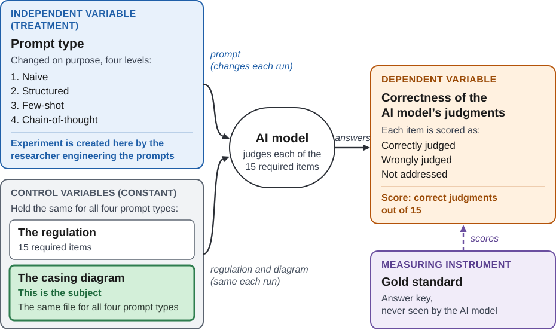
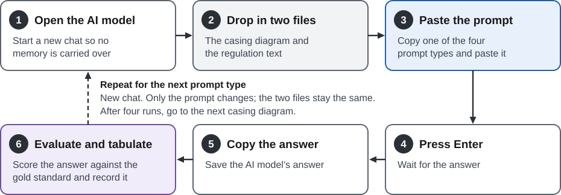

# 3. Research Design and Methods

> Requirement: Explain the data you plan to collect, your research design, and a tentative research schedule. Identify the limitations and risks you anticipate and how you will handle each.

## 3.1 Data to Be Collected

> This section is for: the AI responses to the prompts, tabulated. The casing diagram sample gets only a short summary here (source, selection rule, sample size, collection date); the full details of how the sample was collected go in an appendix.

The diagrams used in this study are those that the California Geologic Energy Management Division (CalGEM) has already received from operators and made publicly available through its Well Statewide Tracking and Reporting System (WellSTAR). This study calls them casing diagrams, the term used in the California Code of Regulations (e.g., Casing Diagrams, 2026). The same documents are filed in WellSTAR under the document type "Wellbore Diagram," and CalGEM's guidance to operators calls them wellbore schematic diagrams (California Geologic Energy Management Division [CalGEM], 2026b).

[Placeholder: the data source, the fields, the sample size, and how the data will be obtained]

## 3.2 Research Design

### 3.2.1 Data Quality Dimension: Completeness

This design will focus on measuring completeness. Lee et al. (2006) described three kinds of completeness (schema completeness, column completeness, and population completeness), and the one that applies here is column completeness: "the degree to which there exist missing values in a column of a table" (p. 56). To apply the definition, each casing diagram will be treated as a record, and each data item that Section 1724.7.1 of Title 14 of the California Code of Regulations says a casing diagram "shall include" (Casing Diagrams, 2026a, subd. (a)) will be treated as a required attribute of that record. In simple terms, in a table each casing diagram is a row, and the columns are the data required for the record to be complete. A diagram is complete when all of its columns have data, and it is incomplete when any column is missing data. Each diagram is an information product, and the artificial intelligence (AI) model will be asked to identify whether that information product is complete.

Completeness of a record will be measured as indicated by Lee et al. (2006, p. 56), as shown in Equation 1.

Completeness of a casing diagram = 1 − (number of required items that are missing ÷ number of required items that apply to the well)   (1)

The regulation lists 15 required data items, numbered (1) through (15), in subdivision (a), and each of these items is one column in the table. Twelve items apply to every well, because every well has an operator, a spud date, elevations, casing, a drilled hole, cement behind the casing, and the other features they describe. Three items describe features that a well may not have, and they apply only when the well has the feature: equipment in the well such as packers or gas lift mandrels (10), cement plugs inside casings (12), and fluid between cement plugs (14). Item (15) applies to every well, but its clause on the top and bottom of the injection zone and confining layers refers to an underground injection project, so for wells outside such a project item (15) is judged on the formations, zones, and markers alone. Whether a conditional item applies to a well will be determined from the well's public records in WellSTAR, not from the diagram alone, because a diagram that omits a feature cannot show whether the feature exists. A column that does not apply to a well is left out of that well's count. For example, a well with no cement plugs has 13 applicable items (items 12 and 14 do not apply); if its diagram is missing 3 of them, its completeness is 1 − (3 ÷ 13) = 0.77, or 77%. A diagram that shows every applicable item has a completeness of 1, or 100%. Subdivisions (b) through (e) of the section cover documents that accompany the diagram, wells with more than one borehole, the depth references, and the option of a flat file; they are not counted among the 15 items.

Measuring other data quality dimensions (accuracy, consistency, believability, appropriate amount of data, timeliness, and accessibility) is not possible in this study, because it would require checking the diagrams against the operators' internal records.

At the point of data collection, the data will be captured from CalGEM's public website, WellSTAR (CalGEM, n.d.-b). Before publication, the data go through a long information product line: each operator draws on its own internal records to supply the data the regulation requires, prepares the diagram, and submits it to CalGEM, which then makes it publicly available. Those internal records are private; access to them is not available for this study and will not be sought. The study will therefore not examine whether the values shown on a diagram are correct, current, or consistent with other records for the well. It will examine only whether each required item is shown and whether the AI model can detect its presence or absence.

### 3.2.2 Design Type and Variables

This study will use a within-subject experimental design. Charness et al. (2012) defined it as follows: "In a 'within-subject' designed experiment, each individual is exposed to more than one of the treatments being tested" (p. 1). In this study, the individual is a casing diagram, and the treatments are the four prompt types. Each casing diagram will be exposed to all four prompt types. The study is an experiment because the researcher will write the prompts and decide which prompt type the AI model receives.

Charness et al. (2012) named three advantages of a within-subject design: (a) internal validity that does not depend on random assignment, (b) often more statistical power, and (c) a closer match to how theory describes a subject reacting to a change (p. 2). They also named its disadvantages, which are confounds that can be introduced by exposing each subject to several treatments, such as the order of exposure and carry-over from one treatment to the next (pp. 2–3). According to the authors, causal estimates can be obtained "as long as there is independence of the multiple exposures" (p. 1), and researchers who use this design "need to make the case that the confounds discussed above do not pose a challenge for the results" (p. 7).

Figure 1 shows the variables of the study and how they relate. The independent variable, or treatment, will be the prompt type. It has four levels: naive, structured (persona, task, context, and format), few-shot, and chain-of-thought. The dependent variable will be the correctness of the AI model's judgments about the presence or absence of each required item. For each of the 15 required items, the AI model's answer will be scored as correctly judged, wrongly judged, or not addressed. Scoring will yield a count of correct judgments, out of 15, for each casing diagram under each prompt type. Two control variables will be held constant: the regulation and the casing diagram. The same regulation text will be given to the AI model in every run, where a run is one prompt type applied to one casing diagram. For any one casing diagram, exactly the same file will be given to the AI model with each of the four prompt types. The casing diagram is also the subject of the experiment.

The dependent variable will be scored with a measuring instrument, the gold standard, which is an answer key that records, for each casing diagram, whether each of the 15 required items is shown, missing, or not applicable to the well. An AI judgment is correct when it matches the gold standard, so an AI model that reports a not-applicable item as missing has judged that item wrongly. Every item therefore receives a judgment, and each run is still scored out of 15. The gold standard will never be given to the AI model, and the same gold standard will be used to score the AI model's answers under all four prompt types.

**Figure 1**

*Relationship Among the Variables of the Study*

*Note.* AI = artificial intelligence. The structured prompt type specifies a persona, task, context, and format. The dashed arrow indicates scoring; the gold standard is not an input to the AI model.

In this study, the subject is a document, so it cannot learn or change between treatments. The AI model could carry information from one prompt type to the next, so each run will start in a new chat [confirm], which will keep the exposures independent. Figure 2 shows the procedure for one casing diagram.

**Figure 2**

*Procedure for Testing One Casing Diagram With the Four Prompt Types*

*Note.* AI = artificial intelligence. One run consists of Steps 1 through 6. Each casing diagram will receive four runs, one for each prompt type (naive, structured, few-shot, and chain-of-thought), and each run will start in a new chat. The dashed arrow indicates the return to Step 1 for the next prompt type.

#### Implications of the Design

Choosing a within-subject design has implications for how the study will be carried out, for how its results will be analyzed, and for what the study must defend.

**Carrying out the study**

1. Every casing diagram will be tested under all four prompt types. If a run fails or its answer is lost, the run will be repeated, or the casing diagram will be removed from the analysis, so that every casing diagram in the analysis has four scores.
2. Each run will be independent of the others. Every run will start in a new chat, so that the AI model carries no information from one run to the next [confirm].

**Analyzing the results**

3. Each run will produce 15 item results. Each required item will be recorded as correctly judged, wrongly judged, or not addressed.
4. Each run will have one score, which is the count of correctly judged items, from 0 to 15. Items wrongly judged and items not addressed will be counted separately, so that the two can be told apart.
5. Each casing diagram will have four scores, one for each prompt type. The comparison will be made within each casing diagram, across its four scores.
6. The scores will be analyzed as related measurements. The four scores for one casing diagram come from the same subject, so statistical tests for related samples will be used, and tests for independent groups will not (see Section 3.3).
7. Each casing diagram will serve as its own comparison. A casing diagram that is hard to read will be equally hard to read under all four prompt types, so differences among casing diagrams will not be mistaken for differences among prompt types.

**Defending the design**

8. The study must make the case that the disadvantages named by Charness et al. (2012) do not affect its results. That case rests on two points made above: the subject is a document that cannot learn or change between treatments, and every run will start in a new chat. Section 3.6 returns to these risks.

The alternative, a between-subject design, would give each casing diagram only one prompt type. Charness et al. (2012) described between-subject designs as more conservative but as having less statistical power than within-subject designs (p. 7).

> **Variables Analysis** (working notes, not proposal text)
>
> **Control Variables (constant):**
>
> 1. The regulation. The same text is given to the AI model in every run of the study.
> 2. The casing diagram. For any one well, each of the four prompts sees exactly the same diagram.
>
> **Independent Variable:**
>
> The prompt type. It is the one thing the study changes on purpose from run to run, and it has four levels:
>
> 1. Naive
> 2. Structured (persona, task, context, format)
> 3. Few-shot
> 4. Chain-of-thought
>
> **Dependent Variable:**
>
> How correctly the AI model detects the presence or absence of each required item. For each of the 15 items, the AI model's answer is scored as correctly judged, wrongly judged, or not addressed. This gives a count (or percentage) of correct judgments per casing diagram for each prompt type.
>
> **Measuring Instrument:**
>
> The gold standard. It is the answer key used to score the dependent variable: for each casing diagram, it records whether each of the 15 required items is shown, missing, or not applicable to the well. The AI model never sees it. The same key scores all four prompt types.

[Placeholder: the procedure step by step]

### 3.2.3 Sample Selection

As of November 13, 2026, in its registry (CalGEM, 2026a), CalGEM has 242,631 registered wells where 147,401 of those are plugged or abandoned, so an operator is not likely to submit any casing diagrams. Those eligible for casing diagrams are 83,567 because they are under the care of an operator. The remaining 11,663 wells are canceled, new, or of unknown status.

In selecting the sample, the following will be considered: CalGEM publishes its casing diagram regulations in two sets, one for underground gas storage wells and one for wells in underground injection projects and idle wells. Gas storage wells are only 280 of the population, so they are not representative of the population, rather a niche very small application. As such, samples will be drawn from the larger population of wells.
Sample selection will be based on simple random sampling without replacement (Kim, 2024, p. 21).

From the 83,287 candidates, 30 wells will be selected, a common size for a pilot study (Lancaster et al., 2004, p. 308). The registry does not show which wells have a casing diagram on file, so the candidates will be placed in a random order and checked one at a time in WellSTAR (CalGEM, n.d.-b). Selection will stop at the 30th well that has a casing diagram.

The 30 casing diagrams will be identified as W01 to W30 and will be used exactly as downloaded. Find in Appendix A the full sampling plan, the screening log, and the evaluation of file quality.

### 3.2.4 Data Specifications

> **Working outline** (not proposal text):
>
> 1. What the standard is — *drafted below*
> 2. When a casing diagram is required (14 CCR triggers; abandonment notice under PRC §§ 3229–3230 and CalGEM guidance)
> 3. When a casing diagram must be updated
> 4. Which of the three lists, and why § 1724.7.1 (done: paragraphs 2 and 3 below)
> 5. The 15 items: number, the regulation's words, applies to every well or only some
> 6. How each item will be judged (move the applicability paragraph from 3.2.1)

This study uses data specifications established by the California Geologic Energy Management Division (CalGEM). These legally binding requirements apply uniformly to California oil and gas operators, while federal agencies and other states maintain their own separate standards. CalGEM publishes its regulations on its website, where they are listed by title, division, chapter, and article of the California Code of Regulations and linked to their official text (CalGEM, n.d.-a).

The data specifications that govern casing diagrams are published in two sets, according to how the well is purposed. A casing diagram of an underground gas storage well must contain 18 data items (Casing Diagrams, 2026c), while a casing diagram of a well in an underground injection project or of an idle well must contain 15 (Casing Diagrams, 2026a, 2026b).

This study focuses on onshore oil and gas wells, using for all of them the set of 15 items from the underground injection control and idle well regulations, and excludes all other wells, such as offshore wells and gas storage wells.
The data specification used in this study is therefore Section 1724.7.1 of Title 14, which states the data that a casing diagram must contain (Casing Diagrams, 2026a).

CalGEM enforces its casing diagram requirements. In 2025, CalGEM ordered an operator to correct the casing diagrams of wells in two underground injection projects and to pay a civil penalty of $1,500, because the diagrams did not comply with Section 1724.7.1 (CalGEM, 2025b, Order No. 1517), the data specification used in this study. The deficiencies named in the order included a missing spud date, true vertical depth that was not given at all depths, and casing modifications that were not documented (CalGEM, 2025b, Order No. 1517). Each of these corresponds to a requirement of the standard used in this study.

CalGEM also reviews the casing diagrams that operators submit, and it expects them to be complete and timely. In a 2025 notice to operators of underground gas storage wells, CalGEM reported that it "has observed inconsistencies in the submission of updated casing diagrams," reminded operators that the required data must be "complete, current, and accurate," and directed them to "submit the updated casing diagram within 60 days after well work is completed" (CalGEM, 2025a, "Casing Diagram Submission Requirements," pp. 1–2).

For operators, these data specifications are a legal obligation, not a voluntary practice or an act of cooperation with the State. Section 1724.7.1 provides that casing diagrams "shall include all of the following data" (Casing Diagrams, 2026a, subd. (a)), and the Public Resources Code, under which CalGEM adopts its regulations, leaves no room to read that word as a recommendation: "'Shall' is mandatory and 'may' is permissive" (Cal. Pub. Res. Code § 15, 1939). The obligation rests on the operator alone: "The operator is responsible for ensuring that the data are current and accurately reflect the project setting and operation throughout the operating life of the project" (Project Data Requirements, 2026, subd. (a)). A missing item on a casing diagram is therefore not a lapse in good practice to be corrected when convenient; it is a violation of law. In Order No. 1517, CalGEM found that the operator's "failure to submit the required UIC project data constitutes violations of Regulations section 1724.7," ordered it to pay civil penalties and submit the data within 30 days, and stated that "daily violations and penalties will continue to accrue" if it did not comply (CalGEM, 2025b, Order No. 1517, pp. 2, 5).

## 3.3 Data Analysis

Because the four scores for one casing diagram come from the same subject, they are related measurements, and statistical tests for independent groups do not apply. The Friedman test will be used to test whether correctness differs across the four prompt types. If it does, Wilcoxon signed-rank tests will compare the prompt types in pairs, with the Holm correction for multiple comparisons [source needed]. These tests were chosen because the score is a count out of 15, and they do not assume that the scores follow a normal distribution.

> **Placeholder: main questions about prompt type** (chosen November 12, 2026; working notes, not proposal text)
>
> | Question | Null hypothesis | Test |
> |---|---|---|
> | Does prompt type affect correctness? | The scores (out of 15) have the same distribution under all four prompt types. | Friedman test |
> | Does correctness rise from naive to structured to few-shot to chain-of-thought? | There is no ordered increase across the four levels. | Page's trend test |
> | Which technique adds something? | Adjacent levels do not differ: structured vs. naive, few-shot vs. structured, chain-of-thought vs. few-shot. | Wilcoxon signed-rank test, with Holm correction |
>
> Each level contains the previous one plus one technique, so each adjacent comparison isolates one technique: structure, examples, or step-by-step reasoning.
>
> To do: state these as the research questions in section 1.3, write them into this section as text, and find a citable source for the tests.

[Placeholder: the measures, the statistical tests or scoring, and the tools]

## 3.4 Ethical Considerations

[Placeholder: whether IRB review is needed, data privacy, and CITI training]

## 3.5 Tentative Research Schedule

| Phase / Task | Target Date | Deliverable |
|---|---|---|
| [Task] | [Date] | [Deliverable] |
| [Task] | [Date] | [Deliverable] |
| [Task] | [Date] | [Deliverable] |
| [Task] | [Date] | [Deliverable] |

## 3.6 Limitations and Risks

> Ideas from 3.2.1 to repeat here (working list, not proposal text):
>
> - **One dimension only.** The study measures completeness. It does not measure accuracy, consistency, believability, appropriate amount of data, timeliness, or accessibility.
> - **One kind of completeness only.** The study uses column completeness. Schema completeness and population completeness are not examined.
> - **No access to private records.** The operators' internal records are private; access is not available for this study and will not be sought.
> - **Values are not validated.** The study will not examine whether the values shown on a diagram are correct, current, or consistent with other records for the well. An item that is shown counts as present even if its value is wrong.
> - **The operator is not audited.** The study examines the published diagram, not the operator's records or practices.
> - **Only the published product is seen.** The data come from the public website, WellSTAR, at the end of a long information product line (operator's records, preparing the diagram, submission to CalGEM, publication). The earlier steps are not observed.
> - **Completeness is measured against the applicable items.** The count covers items (1) through (15) of subdivision (a) of Section 1724.7.1. Twelve apply to every well; (10), (12), and (14) apply only when the well has the feature, as determined from its public records in WellSTAR. A public record that is itself incomplete could lead to a conditional item being wrongly marked as not applicable.
> - **Presence or absence only.** The AI model is asked to detect whether each required item is shown, nothing more.

| Limitation or Risk | Likelihood / Impact | How It Will Be Handled |
|---|---|---|
| [Risk] | [Low/Med/High] | [Contingency] |
| [Risk] | [Low/Med/High] | [Contingency] |
| [Risk] | [Low/Med/High] | [Contingency] |

## References cited in this section

> Working list; move these entries to the proposal's References section.

California Geologic Energy Management Division. (n.d.-a). *California Geologic Energy Management Division statutes and regulations*. California Department of Conservation. Retrieved November 13, 2026, from https://www.conservation.ca.gov/index/Pages/California-Geologic-Energy-Management-Division-Statutes-and-Regulations.aspx

California Geologic Energy Management Division. (n.d.-b). *WellSTAR* [Database]. California Department of Conservation. Retrieved November 10, 2026, from https://wellstar-public.conservation.ca.gov/

California Geologic Energy Management Division. (2025a, December 5). *Casing diagram submission requirements* [Notice to underground gas storage operators]. California Department of Conservation. https://web.archive.org/web/20260125125658/https://www.conservation.ca.gov/calgem/gas-storage-disclosure/Documents/Casing%20Diagram%20Submission_UGS%20NTO_Dec%202025.pdf

California Geologic Energy Management Division. (2025b). *Order to perform remedial work and pay civil penalties* (Order No. 1517). California Department of Conservation. https://www.conservation.ca.gov/calgem/Documents/Orders/1517%20Sentinel%20Peak%20Resources%20California%20LLC_ADA.pdf

California Geologic Energy Management Division. (2026a). *Oil and gas wells table, California* [Data set; file AllWells_20261113.csv]. California Department of Conservation. Retrieved November 13, 2026, from https://gis.conservation.ca.gov/portal/home/item.html?id=0d30c4d9ac8f4f84a53a145e7d68eb6b

California Geologic Energy Management Division. (2026b). *Permitting, forms, and compliance*. California Department of Conservation. Retrieved November 12, 2026, from https://www.conservation.ca.gov/calgem/for_operators

Cal. Pub. Res. Code § 15 (1939). https://leginfo.legislature.ca.gov/faces/codes_displaySection.xhtml?lawCode=PRC&sectionNum=15.

Casing Diagrams, Cal. Code Regs. tit. 14, § 1724.7.1 (2026a). https://www.law.cornell.edu/regulations/california/14-CCR-1724.7.1

Casing Diagrams, Cal. Code Regs. tit. 14, § 1772.1.3 (2026b). https://www.law.cornell.edu/regulations/california/14-CCR-1772.1.3

Casing Diagrams, Cal. Code Regs. tit. 14, § 1726.4.1 (2026c). https://www.law.cornell.edu/regulations/california/14-CCR-1726.4.1

Project Data Requirements, Cal. Code Regs. tit. 14, § 1724.7 (2026). https://www.law.cornell.edu/regulations/california/14-CCR-1724.7

Charness, G., Gneezy, U., & Kuhn, M. A. (2012). Experimental methods: Between-subject and within-subject design. *Journal of Economic Behavior & Organization, 81*(1), 1–8. https://doi.org/10.1016/j.jebo.2011.08.009

Kim, J. K. (2024). *Statistics in survey sampling* (arXiv:2401.07625v4) [Preprint]. arXiv. https://doi.org/10.48550/arXiv.2401.07625

Lancaster, G. A., Dodd, S., & Williamson, P. R. (2004). Design and analysis of pilot studies: Recommendations for good practice. *Journal of Evaluation in Clinical Practice, 10*(2), 307–312. https://doi.org/10.1111/j..2002.384.doc.x

Lee, Y. W., Pipino, L. L., Funk, J. D., & Wang, R. Y. (2006). *Journey to data quality*. MIT Press.

## Google Drive source folder tracker

> Working checklist for the source verification folder ("Research Proposal" in Google Drive). Not part of the proposal text.

| Source | Added to Google Drive | File name in Drive | Highlighted |
|---|---|---|---|
| Casing Diagrams (2026a), § 1724.7.1 | Yes, November 12, 2026 (the study standard) | Casing Diagrams, 2026a, Cal. Code Regs. tit. 14, 1724.7.1, Legal Information Institute.pdf | Subdivision (a), items (1) to (15) |
| Casing Diagrams (2026b), § 1772.1.3 | Yes, November 12, 2026 | Casing Diagrams, 2026b, Cal. Code Regs. tit. 14, 1772.1.3, Legal Information Institute.pdf | Subdivision (a), items (1) to (15) |
| Casing Diagrams (2026c), § 1726.4.1 | Yes, November 12, 2026 (replaced the 2018 final-text PDF); renamed to 2026c November 12, 2026 | Casing Diagrams, 2026c, Cal. Code Regs. tit. 14, 1726.4.1, Legal Information Institute.pdf | Section 1726.4.1, pages 1 to 3 |
| CalGEM (n.d.-a), Statutes and Regulations page | No (web page; text copy at 04-literature/regulatory/) | California Geologic Energy Management Division Statutes and Regulations, n.d., CalGEM website.txt | Title 14, Chapter 4, Subchapter 1, Article 4, Underground Injection Control (§§ 1724.5–1724.13), which contains § 1724.7.1 |
| Cal. Pub. Res. Code § 15 (1939) | No (ready to upload from 04-literature/papers/) | Cal. Pub. Res. Code 15, 1939, California Legislative Information.pdf | Section 15, "'Shall' is mandatory and 'may' is permissive" |
| Project Data Requirements (2026), § 1724.7 | No (ready to upload from 04-literature/papers/) | Project Data Requirements, 2026, Cal. Code Regs. tit. 14, 1724.7, Legal Information Institute.pdf | Subdivision (a), "The operator is responsible for ensuring that the data are current ..." |
| CalGEM (2025a), Notice to UGS Operators, Dec 5, 2025 | No (ready to upload from 04-literature/papers/) | California Geologic Energy Management Division, 2025a, Casing Diagram Submission Requirements, Notice to Underground Gas Storage Operators.pdf | Highlighted: p. 1, "has observed inconsistencies" and the date; p. 2, "complete, current, and accurate" and the 60-day directive |
| CalGEM (2025b), Order No. 1517 | Uploaded; replace in Drive with the 2025b copy (renamed, with two more highlights: p. 2, "constitutes violations"; p. 5, "daily violations and penalties") | California Geologic Energy Management Division, 2025b, Order No. 1517 to Perform Remedial Work and Pay Civil Penalties.pdf | Highlighted: p. 3, the finding that the diagrams do not comply with § 1724.7.1, the list of deficiencies, and the undocumented casing modifications; p. 4, the $1,500 penalty; p. 7, the signature date 4/24/2025 |
| CalGEM (2026a), Oil and Gas Wells Table, California | Yes, November 13, 2026 | CalGEM, 2026, Oil and Gas Wells Table, California (downloaded 2026-11-13).zip (rename of AllWells.zip) | Not applicable (data set); the counts by WellStatus are recorded in 05-data/calgem/PROVENANCE.md, section 12 |
| CalGEM (2026b), Permitting, Forms, and Compliance | No (web page; text copy at 04-literature/regulatory/wellbore-diagram-sources/) | Permitting, Forms, and Compliance, 2026, CalGEM For Operators page.txt | Plugging and Abandonment section, "wellbore schematic diagram" |
| Charness et al. (2012) | Yes, November 12, 2026 | Charness, 2012, Experimental Methods - Between-Subject and Within-Subject Design, Journal of Economic Behavior & Organization.pdf | Page 1, the within-subject and between-subject definitions |
| Hertzog (2008) | Not confirmed | Hertzog, 2008, Considerations in Determining Sample Size for Pilot Studies, Research in Nursing & Health.pdf | Pages 180, 181, and 190 (per the sampling plan) |
| Julious (2005) | Not confirmed | Julious, 2005, Sample Size of 12 per Group Rule of Thumb for a Pilot Study, Pharmaceutical Statistics.pdf | Page 287 (per the sampling plan) |
| Kim (2024) | No (ready to upload from 04-literature/papers/) | Kim, 2024, Statistics in Survey Sampling, arXiv Preprint.pdf | Page 2, "simple random sampling assigns equal probability of selection to each element"; page 21, Section 3.2, "select one realization at random with equal probability ... simple random sampling (SRS) without replacement"; page 27, Section 3.4, with-replacement sampling and duplicate selections |
| Lancaster et al. (2004) | Not confirmed | Lancaster, 2004, Design and Analysis of Pilot Studies - Recommendations for Good Practice, Journal of Evaluation in Clinical Practice.pdf | Page 308 (per the sampling plan) |
| Lee et al. (2006) | Yes, November 12, 2026 | Lee, 2006, Journey to Data Quality, MIT Press.pdf | Page 56, the completeness definition |
