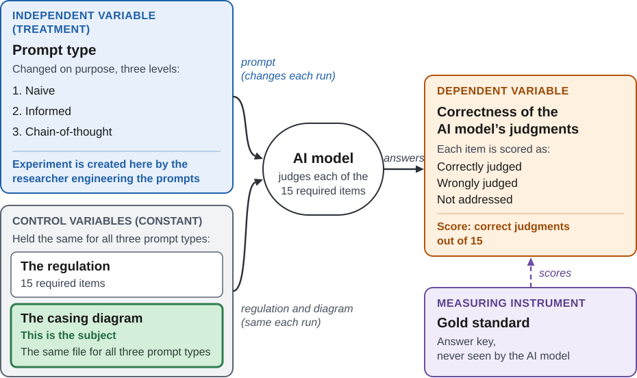
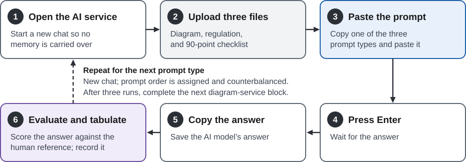

# 3. Research Design and Methods

> Requirement: Explain the data you plan to collect, your research design, and a tentative research schedule. Identify the limitations and risks you anticipate and how you will handle each.

## 3.1 Data to Be Collected

The data to be collected are the models' responses and the scoring records used to evaluate them. In each run, an artificial intelligence (AI) model is asked to qualify the completeness of one casing diagram. Each of the 30 casing diagrams in the sample will be given to each of the three AI models under all three prompt types, so the study will produce 270 runs, 90 per model.

Before the model responses are scored, one human reviewer will inspect each diagram and create a reference record for it. Section 1724.7.1(a) presents 15 numbered requirement groups, but several groups contain more than one separately testable datum. The 15 groups are therefore decomposed into **51 atomic data points**. The 51 diagram-level points, rather than the 15 grouped headings, are the units of observation for the human-reference score and the evaluation of each AI response. For each atomic data point, the reference record will identify only whether the point is met or missing. Each corresponding AI judgment will then be classified as correctly judged, wrongly judged, or not addressed (see Section 3.2.2).

The models are the free versions of ChatGPT (OpenAI), Claude (Anthropic), and Gemini (Google), which can be used without a subscription. Each response will be identified by the model that produced it. The casing diagrams are the subjects being qualified, and Section 3.2.1 defines the completeness score recorded by the human reviewer for each diagram.

Table 1 shows the nine runs for one casing diagram, W01. The diagram file and the wording of each prompt type are the same for all three models, and the same nine runs are repeated for each of the 30 diagrams.

**Table 1**

*Runs for One Casing Diagram (W01)*

| AI model | Naive | Informed | Chain-of-thought |
|---|---|---|---|
| ChatGPT | Run 1 | Run 2 | Run 3 |
| Claude | Run 4 | Run 5 | Run 6 |
| Gemini | Run 7 | Run 8 | Run 9 |

*Note.* Total observations: 30 casing diagrams × 3 AI models × 3 prompt types = 270 runs, each producing one response.

Doing the 270 runs by hand risks attaching the wrong diagram or pasting the wrong prompt. A Python script that uses the Playwright library, which "can be used as a general purpose browser automation tool" (Microsoft, n.d.), will open a new chat, attach the files, paste the prompt, and save the response, in the same way every time. The script captures the response and does not create, judge, or alter it, and the procedure can be reviewed and repeated because it is written as code.

Because the free versions may be updated without notice, all 270 runs will be completed within a short period, and the date of each run will be recorded. Each response will be saved word for word in its own file, named by diagram, model, and prompt type (for example, W01-chatgpt-naive.txt). The SQLite database will link the human-reference results for each diagram to the 61 requirement records maintained for the full Section 1724.7.1 specification. Of those 61 records, 51 are diagram-data requirements in subdivision (a), while 10 are supporting-documentation requirements in subdivision (b). The AI completeness comparison will use the 51 diagram-data points. A run table will hold one row per run: the diagram, the model, the prompt type, the date, the 51-point denominator, the counts of points correctly judged, wrongly judged, and not addressed, and the resulting accuracy.

## 3.2 Research Design

### 3.2.1 Data Quality Dimension: Completeness

The model is asked to qualify the completeness of each casing diagram. Of the three kinds in Lee et al. (2006), the qualification uses column completeness: "the degree to which there exist missing values in a column of a table" (p. 56). Each casing diagram is a record, and each data item that Section 1724.7.1 of Title 14 of the California Code of Regulations says a casing diagram "shall include" (Casing Diagrams, 2026a, subd. (a)) is a required attribute. The diagram is a row, the atomic data points are columns, and the diagram is incomplete to the degree that required columns are missing. Completeness of one record follows Lee et al. (2006, p. 56), as shown in Equation 1.

Completeness of a casing diagram = number of atomic data points marked met ÷ 51   (1)

Section 1724.7.1(a) lists 15 numbered groups. They are not, however, 15 equivalent data fields. For example, item (a)(1) asks for the operator name, lease name, well number, and API number, while item (a)(7) asks separately for casing size, grade, connection type, and weight. To prevent one response from receiving credit for only part of a grouped requirement, the 15 numbered groups are decomposed into **51 atomic data points**. Each atomic point receives one unambiguous status: `MET` or `MISSING`. The current normalization contains 51 atomic data points from subdivision (a) and 10 additional points from the accompanying-document requirements in subdivision (b), for 61 stored specification requirements in total.

The human reviewer must make only a **presence decision**, not a truth, quality, or plausibility judgment. A point is `MET` when an answer is supplied for the required atomic data point. The supplied answer may be a value, “none,” “N/A,” or another explicit entry. A point is `MISSING` only when no answer is supplied. Thus, an unusual or implausible entry still counts as `MET` because the purpose is to measure completeness, not accuracy. The reviewer may preserve the observed wording in a note, but must not reduce the score because the value appears suspect. A blank or omitted field is `MISSING`.

Repeated structures are evaluated as instances of the same atomic requirement. If a diagram contains several casing strings, cement jobs, drilled intervals, perforation intervals, boreholes, or geological intervals, the relevant atomic fields must contain an answer for every instance represented. The requirement is marked `MET` only after every represented instance has an answer. This prevents a supplied value for one casing string from concealing a blank value for another. Subdivision (c), which requires the information to cover original and subsequent boreholes, and subdivision (d), which requires measured depth and true vertical depth, operate as coverage rules across the atomic points rather than as additional counted data points. Equation 1 is the definition applied to the human-reference record described in Section 3.2.2.

The qualification does not cover accuracy, consistency, believability, appropriate amount of data, timeliness, or accessibility. Checking those dimensions would require the operators' internal records, which are private and will not be sought. The diagrams are taken from WellSTAR (CalGEM, n.d.-b), the public site of the California Geologic Energy Management Division (CalGEM), after the operator has prepared the diagram from its own records and submitted it. The qualification covers whether each of the 51 atomic data points is represented on that published diagram and does not verify the truth, quality, or plausibility of a value.

### 3.2.2 Design Type and Variables

This study will use a within-subject experimental design. Charness et al. (2012) defined it as an experiment in which "each individual is exposed to more than one of the treatments being tested" (p. 1). The individual is a casing diagram, and the treatments are the three prompt types, so each diagram receives every prompt type. The study is an experiment because the researcher writes the prompts and assigns the prompt type. Charness et al. named the advantages as internal validity that does not depend on random assignment, greater statistical power, and a closer match to a subject reacting to a change, and the risks as order and carry-over across exposures (pp. 1–3). A causal estimate requires the exposures to be independent (p. 1). A between-subject design would give each diagram one prompt type and would have less power (p. 7).

Figure 1 shows the variables. The independent variable is the prompt type: naive, informed (persona, task, context, and format), and chain-of-thought. The dependent variable is how well the model qualified the completeness of the casing diagram. The same regulation text is given in every run, and the same diagram file is given with each prompt type. A run is one prompt type applied to one diagram on one model. The diagram is the subject of the experiment.

The reference against which the responses will be scored is produced by one human visual inspection of each published casing diagram. The reviewer will use a structured Excel checklist that preserves all 61 atomic requirements for schema coverage. The first 51 rows represent the subdivision-(a) casing-diagram fields and form the scoring instrument for this study; the final 10 rows preserve the subdivision-(b) supporting-documentation fields but are not included in the visual diagram score because they may require records that accompany, rather than appear on, the diagram. For each scored row, the reviewer records the observed status, the displayed value, the location of the evidence on the diagram, and any optional note. The checklist also retains the regulation code and the database destination for each point. This provides an auditable bridge between the visible diagram, the review decision, and the stored result.

The completed human review will be loaded into a SQLite database. The `diagrams` table is the parent for each diagram number, such as W01, and every extracted well, borehole, interval, cement, equipment, geological, and evaluation record is associated with that diagram through direct or inherited foreign-key relationships. The `spec_requirements` table preserves the 61 atomic requirements, and the `diagram_requirement_results` table stores the human-reference result for each requirement and diagram combination. Completeness infractions are generated for points marked `MISSING`. The scoring view filters to subdivision (a) and calculates the final human-reference score as the number of `MET` points divided by 51, excluding the 10 supporting-documentation fields. The stored score, rather than a separate manual estimate, becomes the reference score for all AI runs on that diagram.

The AI response is then tabulated against that human-reference record. For each of the 51 atomic points, an AI judgment is classified as correct or wrong by comparison with the human result; a point that the model does not address is classified as not addressed and counts as incorrect in the run-accuracy calculation. The primary AI accuracy measure is the number of atomic points correctly judged divided by 51:

AI judgment accuracy = atomic data points correctly judged ÷ 51   (2)

Equation 1 states how complete the diagram is according to the human reference. Equation 2 states how well an AI response identified the same reference status for each atomic point. These are distinct outcomes. The human-reference results are never given to the model, and the same reference record is used for all prompt types and all three models evaluating a given diagram. A separate human reviewer will not be introduced as part of this pilot; instead, the single-review procedure, point-level evidence, stable checklist, and retained source diagram provide a traceable baseline for the study.

**Figure 1**

*Relationship Among the Variables of the Study*

*Note.* AI = artificial intelligence. The informed prompt type specifies a persona, task, context, and format. The dashed arrow indicates scoring; the human-reference record is not an input to the AI model.

In this study, the subject is a document, so it cannot learn or change between treatments. The AI model could carry information from one prompt type to the next, so each run will start in a new chat [confirm], which will keep the exposures independent. Figure 2 shows the procedure for one casing diagram.

**Figure 2**

*Procedure for Testing One Casing Diagram With the Three Prompt Types*

*Note.* AI = artificial intelligence. One run consists of Steps 1 through 6, and the procedure is followed for each model. The dashed arrow indicates the return to Step 1 for the next prompt type.

Every diagram will be tested under all three prompt types. If a run fails or its response is lost, the run will be repeated or the diagram will be removed, so that every diagram in the analysis has an accuracy score for each prompt type. Each run produces results for all 51 atomic points; points judged wrongly are counted separately from points not addressed. The three scores for one diagram are related measurements, compared within the diagram with tests for related samples (see Section 3.3). A diagram that is hard to read is equally hard to read under all three prompt types. The defense against the carry-over named by Charness et al. (2012) is that the subject is a document and each run starts in a new chat. Section 3.6 returns to these risks.

> **Variables Analysis** (working notes, not proposal text)
>
> **Control Variables (constant):**
>
> 1. The regulation. The same text is given to the AI model in every run of the study.
> 2. The casing diagram. For any one well, each of the three prompts sees exactly the same casing diagram.
>
> **Independent Variable:**
>
> The prompt type. It is the one thing the study changes on purpose from run to run, and it has three levels:
>
> 1. Naive
> 2. Informed (persona, task, context, format)
> 3. Chain-of-thought
>
> **Dependent Variable:**
>
> How well the model qualified the diagram's completeness. The response is tabulated against the human-reference record for each of the 51 atomic data points as correctly judged, wrongly judged, or not addressed. The run score is the proportion of atomic data points correctly judged. Equation 1 states the diagram's completeness; Equation 2 states how well the model qualified it.
>
> **Measuring Instrument:**
>
> The human-reference record. It is created through the 51 scoring rows of a 61-row specification checklist and stored in SQLite. The record scores each atomic data point as met or missing based only on the presence of a supplied answer. The AI model never sees the record. The same record scores all prompt types and models for that diagram.

#### 3.2.2.1 Reference-Scoring Procedure for Each Diagram

1. **Make only a presence decision, not a truth, quality, or plausibility judgment.**
2. Assign the diagram its study identifier, from W01 through W30, and retain the original downloaded file.
3. Open the diagram and the one-to-one human-review checklist.
4. Work in the regulation's order from atomic point 1 through atomic point 51.
5. For every point, record `MET` or `MISSING`.
6. Mark `MET` when the diagram supplies an answer, including a value, “none,” “N/A,” or another explicit entry.
7. Mark `MISSING` only when no answer is supplied.
8. Record the displayed value and its location on the diagram. Optional notes may preserve unusual wording without changing the status.
9. Load the reviewed values and statuses into SQLite under the diagram's identifier.
10. Run the database's completeness view and inspect the generated infractions and final score.
11. Freeze the reference result before evaluating any AI response for that diagram.
12. Score every AI response against the frozen record at the same atomic level.

This is a comprehensive working procedure for the draft. Later publication versions may condense the database and scoring explanation while retaining the 51-point basis and the formulas.

### 3.2.3 Prompt Engineering and Experimental Conditions

The independent variable is prompt type. The three conditions use the same casing diagram, regulatory specification, 51-point atomic checklist, measurement task, and response structure. This control is necessary because the dependent variable is whether the model correctly identifies the presence or absence of each atomic data point. A prompt that also asked the model to judge engineering correctness, regulatory admissibility, plausibility, or validity would measure a different task and would not align with the human-reference score.

All three prompts use only a presence decision:

- `MET` means that the diagram supplies an answer for the point.
- `MISSING` means that the diagram supplies no answer for the point.
- A value, “none,” “N/A,” or another explicit entry is `MET`.
- Truth, quality, plausibility, engineering validity, and regulatory adequacy are outside scope.
- Each prompt requests exactly one row for every one of the 51 atomic points.

The common attachment set contains the original casing diagram, the verbatim Section 1724.7.1 specification, and the 51-point atomic checklist. The checklist preserves the regulation's 15 numbered groups while decomposing them into separately scoreable fields.

Table 2 summarizes the experimental progression.

**Table 2**

*Three Prompt Conditions*

| Level | Prompt type | Prompting technique | Relationship to prior level |
|---|---|---|---|
| 1 | Naive | Minimal worker-style task request | Establishes the common task |
| 2 | Informed | Persona, task, context, and format | Retains Level 1 and adds PTCF framing |
| 3 | Chain-of-thought | Structured step-by-step instruction | Retains Level 2 unchanged and adds one reasoning instruction |

#### Prompt 1 — Naive

This condition provides the shortest natural-language request that still identifies the measurement task and required 51-point output. It does not assign a persona or provide a stepwise procedure.

> Review the attached casing diagram using the attached 51-point checklist from CalGEM's 14 CCR § 1724.7.1 requirements. Make only a presence decision for each point: mark `MET` when the diagram supplies an answer, including a value, “none,” or “N/A,” and mark `MISSING` when no answer is supplied. Do not judge whether the answer is true, plausible, complete as engineering data, or valid. Return exactly 51 rows, one for each checklist point, with these columns: Point ID, Specification Code, Displayed Answer, and Status.

#### Prompt 2 — Informed (persona, task, context, and format)

This condition retains the Level 1 request unchanged and adds explicit persona, task, context, and format framing. The framing is intended to improve the model's understanding of role and task boundaries without changing the 51-point measurement rule.

> Persona: You are an information-completeness reviewer examining a public CalGEM casing diagram. Task and context: I need a presence-only review so that a human researcher can compare the result with a fixed 51-point reference record. Review the attached casing diagram using the attached 51-point checklist from CalGEM's 14 CCR § 1724.7.1 requirements. Make only a presence decision for each point: mark `MET` when the diagram supplies an answer, including a value, “none,” or “N/A,” and mark `MISSING` when no answer is supplied. Do not judge whether the answer is true, plausible, complete as engineering data, or valid. Return exactly 51 rows, one for each checklist point, with these columns: Point ID, Specification Code, Displayed Answer, and Status. Format: Return the rows in checklist order. Enter `MET` or `MISSING` in Status. Copy only what is displayed when evidence is present. Do not add recommendations, compliance conclusions, or a different item count.

#### Prompt 3 — Chain-of-thought

This condition retains the complete Level 2 prompt unchanged and adds one step-by-step instruction. The prompt asks for a brief sequential process followed by the structured answer; it does not request engineering validation.

> Persona: You are an information-completeness reviewer examining a public CalGEM casing diagram. Task and context: I need a presence-only review so that a human researcher can compare the result with a fixed 51-point reference record. Review the attached casing diagram using the attached 51-point checklist from CalGEM's 14 CCR § 1724.7.1 requirements. Make only a presence decision for each point: mark `MET` when the diagram supplies an answer, including a value, “none,” or “N/A,” and mark `MISSING` when no answer is supplied. Do not judge whether the answer is true, plausible, complete as engineering data, or valid. Return exactly 51 rows, one for each checklist point, with these columns: Point ID, Specification Code, Displayed Answer, and Status. Format: Return the rows in checklist order. Enter `MET` or `MISSING` in Status. Copy only what is displayed when evidence is present. Do not add recommendations, compliance conclusions, or a different item count.
>
> **Step-by-step instruction:** Before producing the table, work through the checklist in order, one point at a time. For each point, locate the place on the diagram where an answer would appear, record the displayed answer if one is supplied, and classify it only as `MET` or `MISSING`. Then return the final 51-row table.

The prompt conditions differ in structure but not in the dependent measure. All three use the same 51-point denominator, presence-only labels, attachments, and row structure. The Level 2 prompt adds PTCF framing to the common request, and Level 3 adds only the step-by-step instruction. This cumulative design allows adjacent-level comparisons to be interpreted as differences associated with the added prompting technique rather than with a different scoring task.

The exact copy-and-paste prompts, atomic checklist, attachment list, and version history will be retained with the study materials. Prior dry-run files produced under the earlier prompt design are not part of the final experimental record. A new dry run using these three prompts will be completed before the 270-run study begins.

### 3.2.4 Sample Selection

The sample is 30 casing diagrams, a size used to estimate a parameter in a pilot study (Lancaster et al., 2004, p. 308). The target population is unplugged California oil and gas wells that have a casing diagram on file. The frame is the 107,952 wells with status Active or Idle in CalGEM's 2021 wells file (CalGEM, 2021). The wells were placed in a simple random order without replacement (Kim, 2024, p. 21) and screened in that order in WellSTAR (CalGEM, n.d.-b), because the frame does not show which wells have a diagram. A well was included when WellSTAR showed that it was not plugged and that it had a legible diagram of the existing well rather than a proposed one. When a well had several such diagrams, the latest was used. Screening stopped at the 30th included well. The diagrams are labeled W01 to W30 and will be used as downloaded. Appendix A contains the sampling plan, the screening log, and the evaluation of file quality.

### 3.2.5 Data Specifications

> **Working outline** (not proposal text):
>
> 1. What the standard is — *drafted below*
> 2. When a casing diagram is required (14 CCR triggers; abandonment notice under PRC §§ 3229–3230 and CalGEM guidance)
> 3. When a casing diagram must be updated
> 4. Which of the three lists, and why § 1724.7.1 (done: paragraphs 2 and 3 below)
> 5. The 15 items: number, the regulation's words, applies to every well or only some
> 6. How each item will be judged (presence only, as described in 3.2.1)

The data specification is CalGEM's casing-diagram rule, published in the California Code of Regulations (CalGEM, n.d.-a). The requirements bind California operators. Federal agencies and other states set their own standards. CalGEM publishes two sets. An underground gas storage well must include 18 items (Casing Diagrams, 2026c). A well in an underground injection project, and an idle well, must include 15 (Casing Diagrams, 2026a, 2026b). This study uses the 15 items in Section 1724.7.1 of Title 14 (Casing Diagrams, 2026a), decomposed into 51 atomic diagram-data points for scoring. Offshore wells and gas-storage wells are outside the study.

CalGEM enforces the requirement. In 2025 it ordered an operator to correct the casing diagrams for two underground injection projects and to pay a civil penalty of $1,500, because the diagrams did not comply with Section 1724.7.1. The named gaps were a missing spud date, true vertical depth not given at all depths, and undocumented casing modifications (CalGEM, 2025b, Order No. 1517). A 2025 notice to underground gas storage operators stated that CalGEM "has observed inconsistencies in the submission of updated casing diagrams," that the data must be "complete, current, and accurate," and that the updated diagram must be submitted within 60 days after well work (CalGEM, 2025a, "Casing Diagram Submission Requirements," pp. 1–2). Section 1724.7.1 provides that casing diagrams "shall include all of the following data" (Casing Diagrams, 2026a, subd. (a)). Under the statute CalGEM administers, "'Shall' is mandatory and 'may' is permissive" (Cal. Pub. Res. Code § 15, 1939), and "the operator is responsible for ensuring that the data are current and accurately reflect the project setting and operation throughout the operating life of the project" (Project Data Requirements, 2026, subd. (a)). In Order No. 1517, CalGEM found that the failure to submit the data was a violation, ordered payment and submission within 30 days, and stated that "daily violations and penalties will continue to accrue" if the operator did not comply (CalGEM, 2025b, pp. 2, 5).

## 3.3 Data Analysis

Because the three accuracy scores for one casing diagram come from the same subject, they are related measurements, and statistical tests for independent groups do not apply. The Friedman test will be used to test whether the model's accuracy differs across the three prompt types. If it does, Wilcoxon signed-rank tests will compare the prompt types in pairs, with the Holm correction for multiple comparisons [source needed]. Accuracy is calculated as the proportion of the 51 atomic data points correctly judged. The analysis will use the point-level counts stored in SQLite, not a reconstructed count from the 15 grouped headings. These tests do not assume normally distributed scores.

> **Research questions mapped to analysis** (working draft)
>
> | Question | Null hypothesis | Test |
> |---|---|---|
> | RQ1: How accurately do the AI assistants judge the 51 atomic data points? | No null hypothesis is required for the descriptive accuracy estimate. | Per-model and combined proportions, with uncertainty summaries |
> | RQ2: Does prompt type affect correctness? | The per-diagram accuracy scores have the same distribution under all three prompt types. | Friedman test |
> | RQ2a: Does correctness rise from naive to informed to chain-of-thought? | There is no ordered increase across the three levels. | Page's trend test |
> | RQ2b: Which technique adds something? | Adjacent levels do not differ: informed vs. naive, chain-of-thought vs. informed. | Wilcoxon signed-rank test, with Holm correction |
>
> Each level contains the previous one plus one technique, so each adjacent comparison isolates one technique: the informing elements (persona, task, context, and format) or step-by-step reasoning.
>
> To do: find a citable source for the statistical tests.

[Placeholder: the measures, the statistical tests or scoring, and the tools]

## 3.4 Ethical Considerations

This study does not use human subjects. No person is recruited, observed, interviewed, or asked to supply data, and no private information is obtained from any oil or gas operator in California. The subjects are casing diagrams and the public well records used to score them. Those records are public documents of the California Geologic Energy Management Division, available through WellSTAR (CalGEM, n.d.-b). Institutional review board approval and informed consent are not required. The study includes no vulnerable participants, deception, or intervention.

Diagrams will be reported by sample number (W01 to W30), not by operator or well name. Model responses will be saved as returned, and the capture script will not alter them. No nonpublic operator record will be added. Results will be reported as scored, without fabrication or falsification, and the saved responses and scores will be retained for review.

## 3.5 Tentative Research Schedule

| Phase / Task | Target Date | Deliverable |
|---|---|---|
| [Task] | [Date] | [Deliverable] |
| [Task] | [Date] | [Deliverable] |
| [Task] | [Date] | [Deliverable] |
| [Task] | [Date] | [Deliverable] |

## 3.6 Limitations and Risks

> Ideas from 3.2.1 to repeat here (working list, not proposal text):
>
> - **One dimension only.** The model is asked to qualify completeness. It is not asked to qualify accuracy, consistency, believability, appropriate amount of data, timeliness, or accessibility.
> - **One kind of completeness only.** The qualification uses column completeness. Schema completeness and population completeness are not examined.
> - **No access to private records.** The operators' internal records are private; access is not available for this study and will not be sought.
> - **Values are not validated.** The study will not examine whether the values shown on a casing diagram are correct, current, or consistent with other records for the well. An item that is shown counts as present even if its value is wrong.
> - **The operator is not audited.** The study examines the published casing diagram, not the operator's records or practices.
> - **Only the published product is seen.** The data come from the public website, WellSTAR, at the end of a long information product line (operator's records, preparing the casing diagram, submission to CalGEM, publication). The earlier steps are not observed.
> - **Completeness and accuracy use a fixed 51-point denominator.** Equations 1 and 2 cover the 51 atomic data points decomposed from items (1) through (15) of subdivision (a) of Section 1724.7.1. A point is met when an answer is supplied and missing when no answer is supplied. The reviewer does not remove points based on an applicability judgment.
> - **A single human inspection creates the reference.** This pilot does not use a multi-reviewer consensus panel. Reviewer error is possible, especially when a diagram is crowded or poorly legible. The stable 51-point checklist, point-level evidence fields, retained source file, and SQLite audit trail make each decision inspectable, but they do not eliminate human error.
> - **Presence-only measurement.** The human reviewer and AI responses distinguish met from missing. The reviewer records `MET` whenever an answer is supplied and `MISSING` whenever no answer is supplied. Truth, quality, plausibility, and engineering validity are outside the study's scope.

| Limitation or Risk | Likelihood / Impact | How It Will Be Handled |
|---|---|---|
| [Risk] | [Low/Med/High] | [Contingency] |
| [Risk] | [Low/Med/High] | [Contingency] |
| [Risk] | [Low/Med/High] | [Contingency] |

## References cited in this section

> Working list; move these entries to the proposal's References section.

California Geologic Energy Management Division. (n.d.-a). *California Geologic Energy Management Division statutes and regulations*. California Department of Conservation. Retrieved November 13, 2026, from https://www.conservation.ca.gov/index/Pages/California-Geologic-Energy-Management-Division-Statutes-and-Regulations.aspx

California Geologic Energy Management Division. (n.d.-b). *WellSTAR* [Database]. California Department of Conservation. Retrieved November 10, 2026, from https://wellstar-public.conservation.ca.gov/

California Geologic Energy Management Division. (2021). *California oil and gas wells* [Data set; file 2021CaliforniaOilAndGasWells.csv]. California Department of Conservation. Retrieved November 10, 2026, from https://filerequest.conservation.ca.gov/

California Geologic Energy Management Division. (2025a, December 5). *Casing diagram submission requirements* [Notice to underground gas storage operators]. California Department of Conservation. https://web.archive.org/web/20260125125658/https://www.conservation.ca.gov/calgem/gas-storage-disclosure/Documents/Casing%20Diagram%20Submission_UGS%20NTO_Dec%202025.pdf

California Geologic Energy Management Division. (2025b). *Order to perform remedial work and pay civil penalties* (Order No. 1517). California Department of Conservation. https://www.conservation.ca.gov/calgem/Documents/Orders/1517%20Sentinel%20Peak%20Resources%20California%20LLC_ADA.pdf

California Geologic Energy Management Division. (2026a). *Oil and gas wells table, California* [Data set; file AllWells_20261113.csv]. California Department of Conservation. Retrieved November 13, 2026, from https://gis.conservation.ca.gov/portal/home/item.html?id=0d30c4d9ac8f4f84a53a145e7d68eb6b

California Geologic Energy Management Division. (2026b). *Permitting, forms, and compliance*. California Department of Conservation. Retrieved November 12, 2026, from https://www.conservation.ca.gov/calgem/for_operators

Cal. Pub. Res. Code § 15 (1939). https://leginfo.legislature.ca.gov/faces/codes_displaySection.xhtml?lawCode=PRC&sectionNum=15.

Casing Diagrams, Cal. Code Regs. tit. 14, § 1724.7.1 (2026a). https://www.law.cornell.edu/regulations/california/14-CCR-1724.7.1

Casing Diagrams, Cal. Code Regs. tit. 14, § 1772.1.3 (2026b). https://www.law.cornell.edu/regulations/california/14-CCR-1772.1.3

Casing Diagrams, Cal. Code Regs. tit. 14, § 1726.4.1 (2026c). https://www.law.cornell.edu/regulations/california/14-CCR-1726.4.1

Project Data Requirements, Cal. Code Regs. tit. 14, § 1724.7 (2026). https://www.law.cornell.edu/regulations/california/14-CCR-1724.7

Charness, G., Gneezy, U., & Kuhn, M. A. (2012). Experimental methods: Between-subject and within-subject design. *Journal of Economic Behavior & Organization, 81*(1), 1–8. https://doi.org/10.1016/j.jebo.2011.08.009

Kim, J. K. (2024). *Statistics in survey sampling* (arXiv:2401.07625v4) [Preprint]. arXiv. https://doi.org/10.48550/arXiv.2401.07625

Lancaster, G. A., Dodd, S., & Williamson, P. R. (2004). Design and analysis of pilot studies: Recommendations for good practice. *Journal of Evaluation in Clinical Practice, 10*(2), 307–312. https://doi.org/10.1111/j..2002.384.doc.x

Lee, Y. W., Pipino, L. L., Funk, J. D., & Wang, R. Y. (2006). *Journey to data quality*. MIT Press.

Microsoft. (n.d.). *Installation | Playwright Python*. Playwright. Retrieved November 13, 2026, from https://playwright.dev/python/docs/intro

## Google Drive source folder tracker

> Working checklist for the source verification folder ("Research Proposal" in Google Drive). Not part of the proposal text.

| Source | Added to Google Drive | File name in Drive | Highlighted |
|---|---|---|---|
| Casing Diagrams (2026a), § 1724.7.1 | Yes, November 12, 2026 (the study standard) | Casing Diagrams, 2026a, Cal. Code Regs. tit. 14, 1724.7.1, Legal Information Institute.pdf | Subdivision (a), items (1) to (15) |
| Casing Diagrams (2026b), § 1772.1.3 | Yes, November 12, 2026 | Casing Diagrams, 2026b, Cal. Code Regs. tit. 14, 1772.1.3, Legal Information Institute.pdf | Subdivision (a), items (1) to (15) |
| Casing Diagrams (2026c), § 1726.4.1 | Yes, November 12, 2026 (replaced the 2018 final-text PDF); renamed to 2026c November 12, 2026 | Casing Diagrams, 2026c, Cal. Code Regs. tit. 14, 1726.4.1, Legal Information Institute.pdf | Section 1726.4.1, pages 1 to 3 |
| CalGEM (n.d.-a), Statutes and Regulations page | No (web page; text copy at calgem/) | California Geologic Energy Management Division Statutes and Regulations, n.d., CalGEM website.txt | Title 14, Chapter 4, Subchapter 1, Article 4, Underground Injection Control (§§ 1724.5–1724.13), which contains § 1724.7.1 |
| Cal. Pub. Res. Code § 15 (1939) | Yes, November 13, 2026 | Cal. Pub. Res. Code 15, 1939, California Legislative Information.pdf | Section 15, "'Shall' is mandatory and 'may' is permissive" |
| Project Data Requirements (2026), § 1724.7 | Yes, November 13, 2026 | Project Data Requirements, 2026, Cal. Code Regs. tit. 14, 1724.7, Legal Information Institute.pdf | Subdivision (a), "The operator is responsible for ensuring that the data are current ..." |
| CalGEM (2025a), Notice to UGS Operators, Dec 5, 2025 | Yes (seen in Drive November 13, 2026) | California Geologic Energy Management Division, 2025a, Casing Diagram Submission Requirements, Notice to Underground Gas Storage Operators.pdf | Highlighted: p. 1, "has observed inconsistencies" and the date; p. 2, "complete, current, and accurate" and the 60-day directive |
| CalGEM (2025b), Order No. 1517 | Yes, November 13, 2026 (2025b copy) | California Geologic Energy Management Division, 2025b, Order No. 1517 to Perform Remedial Work and Pay Civil Penalties.pdf | Highlighted: p. 3, the finding that the diagrams do not comply with § 1724.7.1, the list of deficiencies, and the undocumented casing modifications; p. 4, the $1,500 penalty; p. 7, the signature date 4/24/2025 |
| CalGEM (2026a), Oil and Gas Wells Table, California | Yes, November 13, 2026 | AllWells.zip | Not applicable (data set); the counts by WellStatus are recorded in calgem/PROVENANCE.md, section 12 |
| CalGEM (2026b), Permitting, Forms, and Compliance | No (web page; text copy at calgem/) | Permitting, Forms, and Compliance, 2026, CalGEM For Operators page.txt | Plugging and Abandonment section, "wellbore schematic diagram" |
| Charness et al. (2012) | Yes, November 12, 2026 | Charness, 2012, Experimental Methods - Between-Subject and Within-Subject Design, Journal of Economic Behavior & Organization.pdf | Page 1, the within-subject and between-subject definitions |
| Hertzog (2008) | No; no longer cited (removed from references November 13, 2026) | Hertzog, 2008, Considerations in Determining Sample Size for Pilot Studies, Research in Nursing & Health.pdf | Pages 180, 181, and 190 (per the sampling plan) |
| Julious (2005) | No; no longer cited (removed from references November 13, 2026) | Julious, 2005, Sample Size of 12 per Group Rule of Thumb for a Pilot Study, Pharmaceutical Statistics.pdf | Page 287 (per the sampling plan) |
| Kim (2024) | Yes, November 13, 2026 | Kim, 2024, Statistics in Survey Sampling, arXiv Preprint.pdf | Page 2, "simple random sampling assigns equal probability of selection to each element"; page 21, Section 3.2, "select one realization at random with equal probability ... simple random sampling (SRS) without replacement"; page 27, Section 3.4, with-replacement sampling and duplicate selections |
| Lancaster et al. (2004) | Yes, November 13, 2026 | Lancaster, 2004, Design and Analysis of Pilot Studies - Recommendations for Good Practice, Journal of Evaluation in Clinical Practice.pdf | Page 308 (per the sampling plan) |
| Lee et al. (2006) | Yes, November 12, 2026 | Lee, 2006, Journey to Data Quality, MIT Press.pdf | Page 56, the completeness definition |
| Microsoft (n.d.), Installation, Playwright Python | No (ready to upload from 04-literature/papers/) | Microsoft, n.d., Installation, Playwright Python.pdf | "The Playwright library can be used as a general purpose browser automation tool" |
