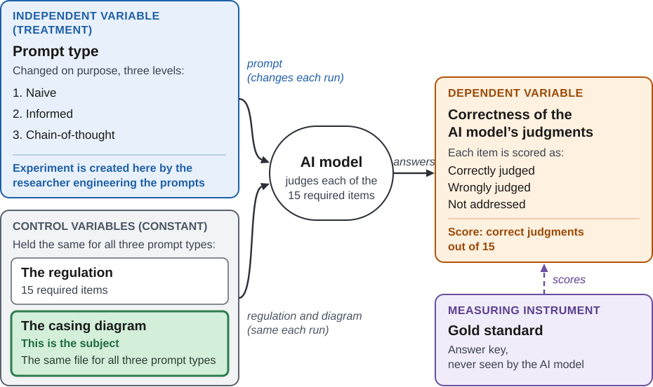
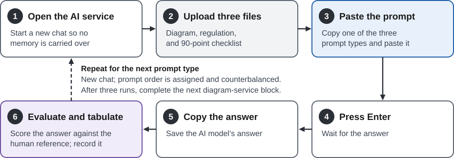

# Prompt Structure and AI-Assisted Completeness Assessment of CalGEM Casing Diagrams

## A Repeated-Measures Comparison of ChatGPT, Claude, and Gemini

**A Research Proposal**

Lester S. Carcamo

University of Arkansas at Little Rock

INFQ 72203 Research Methods

Program: Information Science

Dr. Ningning Wu and Dr. Serhan Dagtas

Fall 2026

## Table of Contents

1. Introduction
2. Literature Review
3. Data, Research Design, and Methods
4. Closing Remarks
5. References
6. AI Tools Acknowledgement

## 1. Introduction

## 1.1 Background and Context

Since beginning my work as a geology technician in June 2008, I have observed interactions among three main groups: oil companies, the people who work within them, and the public in the communities where these companies operate. Each group brings different interests and expectations, but its priorities are not fixed. I have watched those priorities shift as economic conditions, regulatory requirements, technological capabilities, and public concerns change, reshaping how the groups interact with one another.

Generative AI use has spread across the globe. Part of its appeal may lie in the promise of “significant efficiency gains” and “new opportunities for innovation” (Liu & Wang, 2026, pp. 1–2). By March 2024, the 40 most-visited generative AI tools were receiving nearly three billion visits per month from across the globe, illustrating the rapid spread of their use (Liu & Wang, 2026). This scale of adoption suggests that AI’s influence may extend beyond those who choose to use it. The age of AI has arrived upon humanity.

As we adapt, I believe we have a responsibility to understand its capabilities and limitations with precision. In my field of geology, we study the formations beneath our feet because their properties affect the homes, schools, hospitals, and infrastructure we build above them, all within the biosphere that sustains our lives. We cannot simply wish the ground’s complexities away; we must understand them and use that knowledge to make sound decisions. I approach AI with the same practical responsibility: to understand what it can do, recognize where it falls short, and determine how to put it to useful work.

For a geology technician like me, that inquiry begins with familiar work. Reviewing a single document may seem straightforward, but repeating the review across hundreds or thousands of cases makes consistent attention increasingly demanding. The possibility of an assistant that helps identify required information and omissions raises a practical question: can AI perform this review reliably enough to be useful?

The case at hand is the evaluation of information completeness in casing diagrams, drawings showing how a well is built. The California Geologic Energy Management Division (CalGEM) establishes requirements for these diagrams. Section 1724.7.1(a) of Title 14 of the California Code of Regulations states that a diagram “shall include” 15 numbered requirement groups (Casing Diagrams, 2026a). These requirements provide an explicit standard for assessing completeness. This study uses existing casing diagrams available in the public record to examine AI’s ability to determine whether the atomic data points within those groups are present or not present.

## 1.2 Problem Statement

Incomplete casing diagrams carry regulatory consequences. In 2025, CalGEM ordered an operator to correct the casing diagrams for two injection projects and pay a civil penalty because the submissions contained several deficiencies, including missing spud dates, formation locations, undocumented casing modifications, and the failure to provide accurate true vertical depth at all depths (CalGEM, 2025b). The penalty was not for TVD alone; however, the order demonstrates the importance of treating TVD as a separately required representation under Section 1724.7.1(d). In the same year, CalGEM notified underground gas storage operators that it had “observed inconsistencies in the submission of updated casing diagrams” (CalGEM, 2025a, p. 1). These examples establish a practical need for consistent presence checks, including MD and TVD, without extending this study into verification of value accuracy.

Consumer AI assistants offer a possible means of supporting this work, but their reliability for the task remains uncertain. Studies have examined large language models assessing documents against required-item checklists, with performance varying by model and checklist (Kataoka et al., 2026; Srinivasan et al., 2025). General-purpose models have also shown low accuracy on some engineering-drawing tasks (Doris et al., 2025; Picard et al., 2025). Within the sources and searches reviewed for this study, no study was identified that tested free consumer AI assistants on the completeness of engineering drawings against a regulatory checklist (see Section 2).

How the task is presented introduces another uncertainty. Prompt wording can change model performance, sometimes improving it and sometimes reducing it (Kojima et al., 2022; Sorin et al., 2025). Companies and workers therefore need evidence about both the accuracy of these assistants and the effect of different prompts before relying on them for casing diagram completeness reviews.

## 1.3 Purpose and Research Questions

The purpose of this study is to evaluate how accurately free consumer AI assistants determine whether the required data in California casing diagrams are present or not present. The study also examines whether prompt type affects that accuracy.

Section 1724.7.1(a) of Title 14 of the California Code of Regulations presents 15 numbered requirement groups, but these groups do not represent 15 equivalent data fields. Several groups contain multiple separately testable data points. For example, item (a)(1) requests the operator name, lease name, well number, and API number, while item (a)(7) requests casing size, grade, connection type, and weight. Subdivision (d) also requires measured depth (MD) and true vertical depth (TVD) for every depth required under subdivision (a). To make the scoring unit consistent, the 15 numbered groups and the MD/TVD requirement are decomposed into **77 atomic data points**. Each atomic point is scored only for the presence of a supplied answer: `MET` means an answer is shown, and `MISSING` means no answer is shown. The reviewer does not judge whether the supplied value is true, plausible, or valid.

The free versions of ChatGPT, Claude, and Gemini will each receive 30 casing diagrams under three prompt types: naive, informed, and chain-of-thought. This design produces 270 responses. Each response will be scored point by point against a human-reference record created through visual inspection of the diagram. The same 77 atomic data points and fixed denominator will be used for the human-reference completeness score and the evaluation of every AI response.

The study addresses two main research questions:

- **RQ1.** How accurately do free consumer AI assistants judge whether each of the 77 atomic data points derived from the 15 numbered requirement groups and the MD/TVD rule in Section 1724.7.1 is present or not present in California casing diagrams?

- **RQ2.** Does the accuracy of those judgments differ across naive, informed, and chain-of-thought prompts?

Two subquestions examine the pattern of any differences:

- **RQ2a.** Does point-level accuracy increase in order from the naive prompt to the informed prompt to the chain-of-thought prompt?

- **RQ2b.** What change in point-level accuracy occurs at each step: from the naive prompt to the informed prompt, and from the informed prompt to the chain-of-thought prompt?

## 1.4 Significance of the Study

For oil company operators, this study provides evidence about one specific application of AI before resources are committed to its use. It measures how accurately free consumer tools perform a familiar review task and which prompts perform best under the study conditions. It does not measure financial return or time savings. Its findings can inform decisions about whether further testing or supervised use is warranted.

For workers, the study places professional judgment at the center of the evaluation. A researcher-prepared human review serves as the reference against which AI responses are scored. The results identify where the assistants agree with that review, where they make incorrect judgments, and where they omit judgments. This evidence can help workers understand the tools’ limitations and the need for continued human oversight.

For research, the study extends checklist-assessment work from scientific text to scanned engineering drawings, applies completeness as a dimension of information quality to a regulatory document, and examines tools available without a subscription (Lee et al., 2006). For regulators such as CalGEM, it offers evidence about whether these tools could help operators identify missing information before submission. For the general public, it illustrates a concrete application through which AI’s capabilities and limitations can be examined.

## 1.5 Definitions of Key Terms

**Casing diagram.** A drawing of a well’s construction that, under Section 1724.7.1, must include 15 numbered data groups and both MD and TVD for required depths, which decompose into 77 atomic data points for this study (Casing Diagrams, 2026a).

**Completeness.** The degree to which required values are present. In this study, a casing diagram is complete to the degree that all 77 atomic data points derived from Section 1724.7.1 have a supplied answer. Completeness concerns the presence of information rather than whether the reported information is true, plausible, or correct (Lee et al., 2006, p. 56; see Section 3.2.1).

**Consumer AI assistant.** A publicly available conversational interface to an AI model. This study examines the versions of ChatGPT, Claude, and Gemini available without a paid subscription.

**Prompt type.** The instructions used to present the review task. A *naive* prompt states the task only. An *informed* prompt adds a persona, task details, context, and response format. A *chain-of-thought* prompt adds an instruction to reason step by step.

**Human-reference record.** The researcher-prepared record identifying, for each of the 77 atomic data points, whether a supplied answer is present or not present in the diagram. The decision concerns presence only; it does not judge the truth, quality, or plausibility of the answer. The record is used to calculate the diagram's completeness score and to evaluate the AI assistants, but is not provided to them.

**WellSTAR.** CalGEM’s public online database of well records, from which the casing diagrams are obtained (CalGEM, n.d.-b).

## 2. Literature Review

This study tests whether general-purpose artificial intelligence (AI) assistants can assess casing-diagram completeness against the 15 items required by Section 1724.7.1(a) of Title 14 of the California Code of Regulations (Casing Diagrams, 2026a). No study identified in the literature reviewed here tests this question directly. Related research addresses data quality, large language models (LLMs) for checklist assessment, engineering compliance, drawing interpretation, well records, prompt design, and answer verification.

## 2.1 Data Quality and the Meaning of Completeness

Data-quality research treats data as a product whose quality matters to its users. Wang et al. (1995) described poor-quality data as common and identified completeness as recording all values for a variable (pp. 623, 632). They also noted a lack of consistent definitions for familiar dimensions such as accuracy (p. 632).

Wang and Strong (1996) defined data quality as fitness for consumers' use and grouped its dimensions as intrinsic, contextual, representational, and accessibility. They placed completeness in the contextual category: quality depends on the task at hand (pp. 6, 20). Here, the task is regulatory assessment, and Section 1724.7.1(a)'s required-item list defines completeness.

Lee et al. (2006) distinguished schema, column, and population completeness, defining column completeness by the presence of missing values (p. 56). Section 3 applies this definition by treating each diagram as a record and each required item as a column. Chandran and Gupta (2022) similarly framed completeness in relation to an operation and found automated data-quality assessment to be an emerging field (pp. 56, 62, 69). Their review predates LLMs and focuses on structured database data.

Thus, data-quality research defines the construct but does not establish how to assess it in drawings, where required information appears as labels, numbers, and symbols that may be typed, handwritten, or scanned.

## 2.2 Large Language Models for Data-Quality Tasks

LLMs have been applied to data cleaning and integration. Narayan et al. (2022) found that GPT-3 matched or exceeded benchmark methods on several tasks when given demonstrations selected by experts; on error detection in the Hospital dataset, F1 rose from 6.9 without demonstrations to 97.8 with ten. Naeem et al. (2024) developed an LLM system to fill missing table values.

Performance depended on expert-selected examples and was not fully predictable (Narayan et al., 2022). Naeem et al. (2024) found that stand-alone GPT-3.5 filled values correctly 97% of the time when answers involved general knowledge, but only 27% and 5% on datasets requiring specialized knowledge (p. 4424). They cautioned that public models may struggle with unfamiliar data and that human intervention remains common (p. 4421).

He et al. (2026) surveyed LLM methods for tabular wrangling and found that performance remains sensitive to prompt design (p. 7091). Converting tables to text can discard visual and layout cues, while multimodal models' use for wrangling and verification remains underdeveloped (pp. 7090, 7094). In engineering, Heuwinkel et al. (2026) identified completeness as a data barrier and cautioned that LLM hallucinations can produce misleading analyses (p. 2350).

LLMs can perform some data-quality tasks, but the evidence largely concerns structured tables and shows weaker performance on unfamiliar data. These studies do not test whether a model can verify required items in a specialized, often scanned drawing.

## 2.3 LLM Assessment of Documents Against Required-Item Checklists

Health-research reporting guidelines provide the closest methodological precedent. CONSORT (Consolidated Standards of Reporting Trials), PRISMA (Preferred Reporting Items for Systematic Reviews and Meta-Analyses), TRIPOD (Transparent Reporting of a multivariable prediction model for Individual Prognosis Or Diagnosis), and COREQ (Consolidated Criteria for Reporting Qualitative Research) specify items that trial reports, reviews, prediction studies, and qualitative studies should contain. Assessing those documents item by item is structurally similar to checking casing diagrams against Section 1724.7.1(a).

Srinivasan et al. (2025) assessed 21,041 randomized-trial articles against CONSORT with GPT-4o-mini. Macro F1 was .86 on an expert-annotated benchmark; in a human review of 70 articles, 81.21% of model decisions were fully correct, while the higher 91.7% figure included partially correct decisions (p. 5). The model often confused absent events with unreported items, so the authors excluded such items and noted that this may have inflated performance (pp. 5, 10). As in the present study, their assessment measured item presence, not quality or accuracy (p. 9).

Spiero et al. (2026) compared five LLMs on 93 TRIPOD items across 70 manually scored papers. Gemini 2.5 Pro and GPT-5 reached mean F1 scores of .74 and .73, respectively, and their supporting quotes were correct in 80%–97% of manually reviewed cases; the authors recommended researcher verification rather than full automation (pp. 1, 8). In a PRISMA 2020 assessment, Kataoka et al. (2026) found that providing a structured checklist increased accuracy to 78.7%–79.7%, compared with 45.2% for manuscript-only input. Across models, accuracy ranged from 68.5% to 86.0%, and false positives were common; one model had 95.1% sensitivity but 49.3% specificity (pp. 1, 6). The authors concluded that expert review remains necessary.

Other studies report high but task-dependent performance. Chen et al. (2025) found that o3-mini reached 90.09% accuracy on CONSORT and 92.07% on SPIRIT; zero-shot prompting was noninferior to few-shot prompting. Chia et al. (2026) reported a mean article-level F1 of .904 for Claude 3.5 Sonnet on 32 COREQ items, noting that clearly defined criteria performed better than criteria requiring interpretation (p. 9). On orthodontic abstracts, Alharbi and Asiri (2024) found stronger agreement on simple than complex items, with the model tending to mark disputed items as reported. Elyoseph et al. (2025) found higher intraclass correlation coefficients (*ICCs*) between human reviewers and ChatGPT-4 (*ICC* = .81–.87) than with Claude Opus (*ICC* = .73–.78); they noted that their prompt had been designed in ChatGPT's interface (pp. 1, 5).

Tsybulnik et al. (2026) most closely match this study's access mode: they assessed 20 trial articles through the standard interfaces of ChatGPT-4o, Gemini 2.5 Flash, and Claude Sonnet 4.6. Mean CONSORT compliance varied from 54.7% to 80.8%, with no pairwise weighted kappa reaching the threshold for substantial agreement (pp. 1–2). Disagreements concerned judgment-dependent items more than structurally explicit ones (p. 6). Because the authors had no human reference standard and ran each model once per article, they could not determine which model was correct or estimate within-model variability (pp. 4, 8).

Across these studies, performance varies by model and checklist, with stronger results for explicit criteria and recurring errors on interpretive or not-applicable items. Several studies report overcalling item presence and recommend human verification. The evidence concerns scientific text, often assessed through programming interfaces; it does not establish performance on drawings, scans, or legally required documents. Supplementary figures and tables were also sometimes unavailable to the models (Spiero et al., 2026, p. 8).

## 2.4 Automated Compliance Checking in Engineering

A related precedent is automated compliance checking (ACC) in building design. In a review of 88 studies published from 2020 to mid-2025, Lee et al. (2026) found that ontology-, graph-, LLM-, and natural language processing (NLP)-based systems each represented 33% of the reviewed work (p. 8). They noted that regulatory ambiguity limits full automation and that assessments based on 2D drawings remain largely manual, despite continued reliance on drawings and scans (pp. 12, 15–16).

Guo et al. (2026) combined computer-vision models with a locally hosted LLM and design-guideline retrieval to assess five floor plans. Retrieval reduced unsupported claims in the pilot, but the authors cautioned that this did not establish regulatory reliability or eliminate the need for professional review (pp. 12, 15). Nawari and Lawal (2026) reported 97% accuracy for their best model in checking roof drawings against the Florida Building Code, while noting that the vision and language components had not been evaluated as a unified pipeline and that the test set lacked confirmed noncompliant drawings (pp. 1, 29–31).

These studies evaluate purpose-built pipelines, not general-purpose assistants used without specialized detectors, curated rules, or retrieval. They also target specific codes and drawing types. The reviewed research therefore does not show what regulators or operators would obtain from consumer AI assistants, particularly for 2D drawings.

## 2.5 Engineering Drawings and Multimodal Models

Multimodal models have shown difficulty interpreting engineering drawings. Picard et al. (2025) tested two vision-language models (VLMs), GPT-4V and LLaVA 1.6 34B, on engineering tasks. GPT-4V distinguished blind from through holes in drawings only 11% of the time, achieved 36% accuracy on engineering textbook problems, and varied with prompt wording (pp. 66, 68–69).

Doris et al. (2025) introduced DesignQA, a benchmark pairing Formula SAE rules with CAD images and engineering drawings; tested models struggled with rule retrieval and drawing interpretation. Reviewing 94 studies, Pagidi and Gardas (2026) reported only 40%–62% GPT-4 accuracy on DesignQA questions requiring dimension and tolerance extraction (p. 8). They found that specialized pipelines generally outperform general-purpose VLMs on engineering text extraction and warned that models may produce plausible answers to ambiguous geometric dimensioning and tolerancing (GD&T) callouts rather than abstain (pp. 18, 46).

Piping and instrumentation diagrams (P&IDs) are the closest drawing type studied. Ali et al. (2026) used computer-vision preprocessing on 32 P&IDs and achieved 83% accuracy in symbol association and 82% in line association; without preprocessing, accuracy on dense petrochemical drawings fell below 10% (pp. 1, 6). They also found that the model rarely abstained when a line lacked a reference (p. 6). Gupta et al. (2025) instead converted synthetic P&IDs into graphs for LLM querying; dynamic examples improved accuracy by 10.6–43.5 percentage points over a schema description, though errors could propagate across pipeline stages (p. 15).

These findings suggest that general-purpose models may perform worse than engineered pipelines on whole drawings and may answer instead of abstaining. In a completeness assessment, that could lead to items being marked present when they are absent or unreadable.

## 2.6 Oil and Gas Well Records

In oil and gas, Ma et al. (2024) used text-only Llama 2 to extract well locations and depths from historical records. Their workflow achieved 100% accuracy on 150 clean PDFs but 70% location accuracy on 10 scanned records with handwriting and stamps; errors were largely associated with optical character recognition (OCR) (pp. 1, 5). More detailed prompts helped, whereas chain-of-thought provided limited improvement (pp. 1, 10).

Liu et al. (2025) increased recognition accuracy on workover-site photographs from .7068 to .8002 by training prompt parameters on more than 25,000 labeled images (p. 1). Unlike user-written instructions, these prompts were trained parameters, and the inputs were photographs rather than documents. No identified study assessed casing-diagram completeness.

## 2.7 Prompt Design and Chain-of-Thought Reasoning

Prompt wording can affect performance, but no style is consistently best. Kojima et al. (2022) found that adding a step-by-step reasoning cue raised accuracy on the MultiArith benchmark from 17.7% to 78.7%, but it did not help commonsense reasoning or smaller models and sometimes led to incorrect revisions. Narayan et al. (2022) likewise found prompt sensitivity: changing one phrase produced an average 9.4-point F1 difference, while expert-selected demonstrations outperformed random ones by 14.7 points.

Evidence from applied tasks is mixed. Sorin et al. (2025) found that few-shot prompting improved recall in radiology classification, whereas chain-of-thought often reduced performance (p. 1). Chain-of-thought yielded limited gains on well records (Ma et al., 2024) and did not outperform few-shot prompting in Chen et al.'s (2025) checklist assessment. Other studies note that vague prompts may encourage hallucination (Anh-Hoang et al., 2025) and that prompts may favor the model for which they were designed (Chia et al., 2026; Elyoseph et al., 2025).

These findings do not establish that performance will increase from a naive to an informed to a chain-of-thought prompt. As described in Section 3, the informed prompt combines persona, task, context, and format, so its effect cannot be attributed to one element. Because the regulation is supplied in every run, checklist access is held constant (Kataoka et al., 2026).

## 2.8 Evidence, Verification, and Long Documents

A model's document judgment needs comparison with the source. Lin et al. (2026) found that evidence cited by GPT-4o-mini, GPT-4o, and Gemini 2.0 Flash reproduced the models' original answers in 65%, 74%, and 53% of cases, respectively; even verifiable evidence did not establish that an answer was correct. Spiero et al. (2026) found supporting checklist quotes correct in 80%–97% of reviewed cases, still leaving room for error.

Evidence position can also matter. Liu et al. (2024) found lower performance when relevant information appeared in the middle of long text contexts; for GPT-3.5-Turbo, performance dropped by more than 20% depending on position (pp. 157, 162). Their text-based experiments raise a question for multi-page diagrams but do not predict performance on them. Waqas et al. (2026) described hallucinations as often presented confidently and recommended human review for high-stakes cases (pp. 1, 15).

Accordingly, a model's claim that an item is present—even with a cited location—must be checked against a human reference judgment.

## 2.9 Scanned and Handwritten Inputs

Ostrow et al. (2026) tested two commercial assistants on 14 scanned anesthesia records using a simple prompt to extract antibiotic, dose, and timing information. Accuracy across all three measures was 21.4% for Claude and 14.3% for OpenAI (p. 1). Performance was near-perfect on typed records but weaker on handwriting and graphic timelines (p. 5), suggesting that scan content and layout can affect extraction.

Other findings are consistent with this limitation: Ma et al. (2024) reported lower accuracy on scanned than clean PDFs, while Ali et al. (2026) used substantial preprocessing for scanned P&IDs. Research has not yet established how general-purpose assistants perform on scanned engineering drawings.

## 2.10 Summary and Research Gap

Table 1 summarizes the literature's contributions and remaining gaps.

**Table 1**

*Summary of the Literature and the Gap It Leaves*

| Body of research | Representative sources | What is known | What is not known |
|---|---|---|---|
| Data quality and completeness | Chandran & Gupta (2022); Lee et al. (2006); Wang et al. (1995); Wang & Strong (1996) | Completeness is contextual and can be defined as missing values in required columns | How to assess completeness automatically in unstructured documents and drawings |
| LLMs for data-quality tasks | He et al. (2026); Naeem et al. (2024); Narayan et al. (2022) | LLMs can clean and fill tables, with performance affected by prompt design | Performance on specialized, scanned, or image-based documents |
| LLM checklist assessment | Alharbi & Asiri (2024); Chen et al. (2025); Chia et al. (2026); Elyoseph et al. (2025); Kataoka et al. (2026); Spiero et al. (2026); Srinivasan et al. (2025); Tsybulnik et al. (2026) | Results vary by model and checklist; errors occur on interpretive or not-applicable items, and some studies report overcalling presence | Performance on drawings, scans, and legal documents; consumer assistants checked against a human reference |
| Compliance checking in engineering | Guo et al. (2026); Lee et al. (2026); Nawari & Lawal (2026) | Purpose-built pipelines have been evaluated on specific codes and drawing types | What general-purpose assistants achieve without specialized pipelines |
| Engineering drawings and multimodal models | Ali et al. (2026); Doris et al. (2025); Gupta et al. (2025); Pagidi & Gardas (2026); Picard et al. (2025) | Some general-purpose models show low accuracy on drawing tasks; performance varies with preprocessing and prompts | Completeness judgments against a regulation on scanned field drawings |
| Oil and gas well records | Liu et al. (2025); Ma et al. (2024) | Scanned records can be harder to process than clean digital records | Any study of casing or wellbore diagrams |
| Prompt design | Anh-Hoang et al. (2025); Kojima et al. (2022); Narayan et al. (2022); Sorin et al. (2025) | Wording matters; chain-of-thought helps some tasks and hurts others | Which prompt type works for completeness judgments on drawings |
| Verification and scanned inputs | Lin et al. (2026); Liu et al. (2024); Ostrow et al. (2026); Waqas et al. (2026) | Cited evidence may not verify an answer; scans and handwriting can reduce extraction accuracy | How consumer assistants perform on scanned engineering documents |

The literature establishes that completeness depends on the task, and that LLMs can assess checklist items in text with varying, imperfect performance. Evidence on engineering drawings and scanned records is more limited and identifies challenges with interpretation, image quality, and abstention.

Within the sources and searches reviewed for this proposal, no study was identified that tests free consumer AI assistants on engineering-drawing completeness against a legal checklist. Checklist studies focus on scientific text; engineering studies use specialized pipelines or different tasks; and well-record studies extract values rather than assess completeness. Tsybulnik et al. (2026) and Picard et al. (2025) are closest in access mode, but neither tests regulatory completeness against a human reference. This study addresses that gap by comparing ChatGPT, Claude, and Gemini on 30 California casing diagrams and the 15 items in Section 1724.7.1(a), across three prompt types, using a human reference.

## 3. Data, Research Design, and Methods

> Requirement: Explain the data you plan to collect, your research design, and a tentative research schedule. Identify the limitations and risks you anticipate and how you will handle each.

## 3.1 Data to Be Collected

The data to be collected are the models' responses and the scoring records used to evaluate them. In each run, an artificial intelligence (AI) model is asked to qualify the completeness of one casing diagram. Each of the 30 casing diagrams in the sample will be given to each of the three AI models under all three prompt types, so the study will produce 270 runs, 90 per model.

Before the model responses are scored, one human reviewer will inspect each diagram and create a reference record for it. Section 1724.7.1(a) presents 15 numbered requirement groups, but several groups contain more than one separately testable datum. Subdivision (d) additionally requires MD and TVD for every depth required under subdivision (a). The 15 groups and the MD/TVD rule are therefore decomposed into **77 atomic data points**. These 77 diagram-level points, rather than the 15 grouped headings, are the units of observation for the human-reference score and the evaluation of each AI response. For each atomic data point, the reference record will identify only whether the point is met or missing. Each corresponding AI judgment will then be classified as correctly judged, wrongly judged, or not addressed (see Section 3.2.2).

The models are the free versions of ChatGPT (OpenAI), Claude (Anthropic), and Gemini (Google), which can be used without a subscription. Each response will be identified by the model that produced it. The casing diagrams are the subjects being qualified, and Section 3.2.1 defines the completeness score recorded by the human reviewer for each diagram.

Table 1 shows the nine runs for one casing diagram, W01. The diagram file and the wording of each prompt type are the same for all three models, and the same nine runs are repeated for each of the 30 diagrams.

**Table 1**

*Runs for One Casing Diagram (W01)*

| AI service | Naive | Informed | Chain-of-thought |
|---|---|---|---|
| ChatGPT | Run 1 | Run 2 | Run 3 |
| Claude | Run 4 | Run 5 | Run 6 |
| Gemini | Run 7 | Run 8 | Run 9 |

*Note.* Total observations: 30 casing diagrams × 3 AI services × 3 prompt types = 270 runs. Each diagram–service pair receives all three prompt conditions and contributes one repeated-measures block.

All 270 runs will be performed manually through the ordinary consumer interfaces. No browser-automation script, bot, scraping process, or programmatic extraction of ChatGPT, Claude, or Gemini responses will be used. This decision is necessary because the published consumer terms for OpenAI and Anthropic restrict automated or programmatic access and extraction, and the research does not assume permission to automate any consumer service (OpenAI, n.d.-a; Anthropic, 2026). Manual execution also keeps account access, uploads, and response copying under the direct control of the researcher.

To reduce attachment and prompt-substitution errors, the researcher will use a run log and pre-run checklist for every observation. The checklist will verify the diagram identifier, AI service, prompt version, assigned prompt order, attachment set, new-chat state, displayed model version when available, and output filename before the response is collected. Prompt order will be counterbalanced across the 90 diagram–service pairs. The response will be copied as returned into its designated file and independently checked against the source conversation. The manual procedure is slower than automation, but it reduces terms-of-service risk and creates an explicit audit trail for each run.

Because the free versions may be updated without notice, all 270 runs will be completed within a short period, and the date of each run will be recorded. Each response will be saved word for word in its own file, named by diagram, model, and prompt type (for example, W01-chatgpt-naive.txt). The SQLite database will link the human-reference results for each diagram to the 87 requirement records maintained for the full Section 1724.7.1 specification. Of those 87 records, 77 are diagram-data requirements in subdivisions (a) and (d), while 10 are supporting-documentation requirements in subdivision (b). The AI completeness comparison will use the 77 diagram-data points. A run table will hold one row per run: the diagram, the model, the prompt type, the date, the 77-point denominator, the counts of points correctly judged, wrongly judged, and not addressed, and the resulting accuracy.

## 3.2 Research Design

### 3.2.1 Data Quality Dimension: Completeness

The model is asked to qualify the completeness of each casing diagram. Of the three kinds in Lee et al. (2006), the qualification uses column completeness: "the degree to which there exist missing values in a column of a table" (p. 56). Each casing diagram is a record, and each data item that Section 1724.7.1 of Title 14 of the California Code of Regulations says a casing diagram "shall include" (Casing Diagrams, 2026a, subd. (a)) is a required attribute. The diagram is a row, the atomic data points are columns, and the diagram is incomplete to the degree that required columns are missing. Completeness of one record follows Lee et al. (2006, p. 56), as shown in Equation 1.

Completeness of a casing diagram = number of atomic data points marked met ÷ 77   (1)

Section 1724.7.1(a) lists 15 numbered groups. They are not, however, 15 equivalent data fields. For example, item (a)(1) asks for the operator name, lease name, well number, and API number, while item (a)(7) asks separately for casing size, grade, connection type, and weight. Subdivision (d) adds an independent requirement that measured depth and true vertical depth be supplied for every depth required under subdivision (a). To prevent one response from receiving credit for only part of a grouped requirement or for one depth representation, the regulation is decomposed into **77 atomic data points**: 25 non-depth points, 26 MD depth points, and 26 corresponding TVD points. Each atomic point receives one unambiguous status: `MET` or `MISSING`. The current normalization contains 77 diagram-data points and 10 additional supporting-documentation points from subdivision (b), for 87 stored specification requirements in total.

The human reviewer must make only a **presence decision**, not a truth, quality, or plausibility judgment. A point is `MET` when an answer is supplied for the required atomic data point. The supplied answer may be a value, “none,” “N/A,” or another explicit entry. A point is `MISSING` only when no answer is supplied. Thus, an unusual or implausible entry still counts as `MET` because the purpose is to measure completeness, not accuracy. For the 26 depth-bearing fields, MD and TVD are separate observations: an MD answer can be `MET` while the corresponding TVD remains `MISSING`. The reviewer may preserve the observed wording in a note, but must not reduce the score because the value appears suspect. A blank or omitted field is `MISSING`.

Repeated structures are evaluated as instances of the same atomic requirement. If a diagram contains several casing strings, cement jobs, drilled intervals, perforation intervals, boreholes, or geological intervals, the relevant MD and TVD fields must contain an answer for every instance represented. The requirement is marked `MET` only after every represented instance has an answer for that depth representation. This prevents a supplied value for one casing string or one depth system from concealing a blank value elsewhere. Subdivision (c), which requires the information to cover original and subsequent boreholes, operates as a coverage rule across the points; subdivision (d)'s MD and TVD obligations are counted as separate atomic points. Equation 1 is the definition applied to the human-reference record described in Section 3.2.2.

The qualification does not cover accuracy, consistency, believability, appropriate amount of data, timeliness, or accessibility. Checking those dimensions would require the operators' internal records, which are private and will not be sought. The diagrams are taken from WellSTAR (CalGEM, n.d.-b), the public site of the California Geologic Energy Management Division (CalGEM), after the operator has prepared the diagram from its own records and submitted it. The qualification covers whether each of the 77 atomic data points is represented on that published diagram and does not verify the truth, quality, or plausibility of a value.

### 3.2.2 Design Type and Variables

This study will use a within-subject experimental design. Charness et al. (2012) defined it as an experiment in which "each individual is exposed to more than one of the treatments being tested" (p. 1). The experimental subject is a diagram–AI service pair. Each of the 30 diagrams is evaluated by each of the three AI services, and each diagram–service pair receives all three prompt types. The resulting blocks are 90 diagram–service pairs, each containing three related measurements, for 270 runs. The design is experimental because the researcher prepares and assigns the prompt type. Charness et al. named the advantages as internal validity that does not depend on random assignment, greater statistical power, and a closer match to a subject reacting to a change, and the risks as order and carry-over across exposures (pp. 1–3). A causal estimate requires the exposures to be independent (p. 1). A between-subject design would give each diagram–service pair one prompt type and would have less power (p. 7).

Figure 1 shows the variables. The independent variable is prompt type: naive, informed (persona, task, context, and format), and chain-of-thought. AI service—ChatGPT, Claude, or Gemini—is a blocking and grouping factor used to report and interpret prompt effects within each service. The primary dependent variable is the proportion of the 77 atomic data points correctly classified as `MET` or `MISSING`. Secondary outcomes are the numbers of points classified wrongly, not addressed, and returned in the requested row structure. The same regulation, checklist, diagram, and human-reference record are used across prompts within a diagram–service pair. A run is one prompt type applied to one diagram in one AI service.

The reference against which the responses will be scored is produced by one human visual inspection of each published casing diagram. The reviewer will use a structured Excel checklist that preserves all 87 atomic requirements for schema coverage. The first 77 rows represent the subdivision-(a) diagram fields and the subdivision-(d) MD/TVD points and form the scoring instrument for this study; the final 10 rows preserve the subdivision-(b) supporting-documentation fields but are not included in the visual diagram score because they may require records that accompany, rather than appear on, the diagram. For each scored row, the reviewer records the observed status, the displayed value, the location of the evidence on the diagram, and any optional note. The checklist also retains the regulation code and the database destination for each point. This provides an auditable bridge between the visible diagram, the review decision, and the stored result.

The completed human review will be loaded into a SQLite database. The `diagrams` table is the parent for each diagram number, such as W01, and every extracted well, borehole, interval, cement, equipment, geological, and evaluation record is associated with that diagram through direct or inherited foreign-key relationships. The `spec_requirements` table preserves the 87 atomic requirements, and the `diagram_requirement_results` table stores the human-reference result for each requirement and diagram combination. Completeness infractions are generated for points marked `MISSING`. The scoring view filters to the 77 diagram-data points and calculates the final human-reference score as the number of `MET` points divided by 77, excluding the 10 supporting-documentation fields. The stored score, rather than a separate manual estimate, becomes the reference score for all AI runs on that diagram.

The AI response is then tabulated against that human-reference record. For each of the 77 atomic points, an AI judgment is classified as correct or wrong by comparison with the human result; a point that the model does not address is classified as not addressed and counts as incorrect in the run-accuracy calculation. The primary AI accuracy measure is the number of atomic points correctly judged divided by 77:

AI judgment accuracy = atomic data points correctly judged ÷ 77   (2)

Equation 1 states how complete the diagram is according to the human reference. Equation 2 states how well an AI response identified the same reference status for each atomic point. These are distinct outcomes. The human-reference results are never given to the model, and the same reference record is used for all prompt types and all three models evaluating a given diagram. A separate human reviewer will not be introduced as part of this pilot; instead, the single-review procedure, point-level evidence, stable checklist, and retained source diagram provide a traceable baseline for the study.

**Figure 1**

*Relationship Among the Variables of the Study*

*Note.* AI = artificial intelligence. The informed prompt type specifies a persona, task, context, and format. AI service is a blocking and grouping factor: ChatGPT, Claude, or Gemini. The repeated-measures block is the diagram–service pair. The dashed arrow indicates scoring; the human-reference record is not an input to the AI service.

In this study, the subject is a fixed diagram–service pair. The diagram itself cannot learn or change between treatments, but the AI service could retain conversational context from one prompt type to another. Each run will therefore start in a new chat. Prompt order will also be recorded and counterbalanced across diagram–service pairs, so the fixed sequence naive–informed–chain-of-thought does not systematically confound prompt type with time, service conditions, upload handling, or researcher familiarity. A new chat addresses conversational carry-over; counterbalancing addresses order effects.

**Figure 2**

*Procedure for Testing One Casing Diagram With the Three Prompt Types*

*Note.* AI = artificial intelligence. One run consists of Steps 1 through 6 and is performed manually. Each diagram–service pair receives all three prompts through new chats in counterbalanced order. The dashed arrow indicates the return to Step 1 for the next assigned prompt type.

Every diagram–service pair will be tested under all three prompt types. If a run fails or its response is lost, the run will be repeated in the same service and condition or the diagram–service block will be excluded with the reason documented. A complete block therefore contains one score for each prompt type. Each run produces results for all 77 atomic points; points judged wrongly are counted separately from points not addressed. The three prompt scores within a block are related measurements, compared with tests for related samples (see Section 3.3). Prompt effects will be evaluated within each AI service, rather than pooling the three service blocks for one independence-assuming test. A diagram that is hard to read is equally represented across the three prompt conditions within each service. New chats and counterbalanced run order address conversational carry-over and order effects. Section 3.6 returns to these risks.

#### 3.2.2.1 Reference-Scoring Procedure for Each Diagram

1. **Make only a presence decision, not a truth, quality, or plausibility judgment.**
2. Assign the diagram its study identifier, from W01 through W30, and retain the original downloaded file.
3. Open the diagram and the one-to-one human-review checklist.
4. Work in checklist order from atomic point 1 through atomic point 77.
5. For every point, record `MET` or `MISSING`.
6. Mark `MET` when the diagram supplies an answer, including a value, “none,” “N/A,” or another explicit entry.
7. Mark `MISSING` only when no answer is supplied.
8. Record the displayed value and its location on the diagram. Optional notes may preserve unusual wording without changing the status.
9. Load the reviewed values and statuses into SQLite under the diagram's identifier.
10. Run the database's completeness view and inspect the generated infractions and final score.
11. Freeze the reference result before evaluating any AI response for that diagram.
12. Score every AI response against the frozen record at the same atomic level.

### 3.2.3 Prompt Engineering and Experimental Conditions

The independent variable is prompt type. The three conditions use the same casing diagram, regulatory specification, 77-point atomic checklist, measurement task, and response structure. This control is necessary because the dependent variable is whether the model correctly identifies the presence or absence of each atomic data point. A prompt that also asked the model to judge engineering correctness, regulatory admissibility, plausibility, or validity would measure a different task and would not align with the human-reference score.

All three prompts use only a presence decision:

- `MET` means that the diagram supplies an answer for the point.
- `MISSING` means that the diagram supplies no answer for the point.
- A value, “none,” “N/A,” or another explicit entry is `MET`.
- Truth, quality, plausibility, engineering validity, and regulatory adequacy are outside scope.
- Each depth-bearing point is scored separately for MD and TVD.
- Each prompt requests exactly one row for every one of the 77 atomic points.

The common attachment set contains the original casing diagram, the verbatim Section 1724.7.1 specification, and the 77-point atomic checklist. The checklist preserves the regulation's 15 numbered groups while decomposing them into separately scoreable fields, including 26 MD/TVD pairs.

Table 2 summarizes the experimental progression.

**Table 2**

*Three Prompt Conditions*

| Level | Prompt type | Prompting technique | Relationship to prior level |
|---|---|---|---|
| 1 | Naive | Minimal worker-style task request | Establishes the common task |
| 2 | Informed | Persona, task, context, and format | Retains Level 1 and adds PTCF framing |
| 3 | Chain-of-thought | Structured step-by-step instruction | Retains Level 2 unchanged and adds one reasoning instruction |

*Note.* PTCF = persona, task, context, and format. All three conditions use the same 77-point checklist, attachments, presence-only rule, and requested output structure. The order of the three prompts is counterbalanced across diagram–service pairs.

#### Prompt 1 — Naive

This condition provides the shortest natural-language request that still identifies the measurement task and required 77-point output. It does not assign a persona or provide a stepwise procedure.

> Review the attached casing diagram using the attached 77-point checklist from CalGEM's 14 CCR § 1724.7.1 requirements. The depth-bearing points are scored separately for measured depth (MD) and true vertical depth (TVD). Make only a presence decision for each point: mark `MET` when the diagram supplies an answer, including a value, “none,” or “N/A,” and mark `MISSING` when no answer is supplied. Do not judge whether the answer is true, plausible, complete as engineering data, or valid. Return exactly 77 rows, one for each checklist point, with these columns: Point ID, Specification Code, Displayed Answer, and Status.

#### Prompt 2 — Informed (persona, task, context, and format)

This condition retains the Level 1 request unchanged and adds explicit persona, task, context, and format framing. The framing is intended to improve the model's understanding of role and task boundaries without changing the 77-point measurement rule.

> Persona: You are an information-completeness reviewer examining a public CalGEM casing diagram. Task and context: I need a presence-only review so that a human researcher can compare the result with a fixed 77-point reference record. Review the attached casing diagram using the attached 77-point checklist from CalGEM's 14 CCR § 1724.7.1 requirements. The depth-bearing points are scored separately for measured depth (MD) and true vertical depth (TVD). Make only a presence decision for each point: mark `MET` when the diagram supplies an answer, including a value, “none,” or “N/A,” and mark `MISSING` when no answer is supplied. Do not judge whether the answer is true, plausible, complete as engineering data, or valid. Return exactly 77 rows, one for each checklist point, with these columns: Point ID, Specification Code, Displayed Answer, and Status. Format: Return the rows in checklist order. Enter `MET` or `MISSING` in Status. Copy only what is displayed when evidence is present. Do not add recommendations, compliance conclusions, or a different item count.

#### Prompt 3 — Chain-of-thought

This condition retains the complete Level 2 prompt unchanged and adds one step-by-step instruction. The prompt asks for a brief sequential process followed by the structured answer; it does not request engineering validation.

> Persona: You are an information-completeness reviewer examining a public CalGEM casing diagram. Task and context: I need a presence-only review so that a human researcher can compare the result with a fixed 77-point reference record. Review the attached casing diagram using the attached 77-point checklist from CalGEM's 14 CCR § 1724.7.1 requirements. The depth-bearing points are scored separately for measured depth (MD) and true vertical depth (TVD). Make only a presence decision for each point: mark `MET` when the diagram supplies an answer, including a value, “none,” or “N/A,” and mark `MISSING` when no answer is supplied. Do not judge whether the answer is true, plausible, complete as engineering data, or valid. Return exactly 77 rows, one for each checklist point, with these columns: Point ID, Specification Code, Displayed Answer, and Status. Format: Return the rows in checklist order. Enter `MET` or `MISSING` in Status. Copy only what is displayed when evidence is present. Do not add recommendations, compliance conclusions, or a different item count.
>
> **Step-by-step instruction:** Before producing the table, work through the checklist in order, one point at a time. For each point, locate the place on the diagram where an answer would appear, record the displayed answer if one is supplied, and classify it only as `MET` or `MISSING`. Then return the final 77-row table.

The prompt conditions differ in structure but not in the dependent measure. All three use the same 77-point denominator, presence-only labels, attachments, and row structure. The Level 2 prompt adds PTCF framing to the common request, and Level 3 adds only the step-by-step instruction. This cumulative design allows adjacent-level comparisons to be interpreted as differences associated with the added prompting technique rather than with a different scoring task.

#### Atomic Data-Point Checklist

Table 3 presents the 77 data points supplied to each AI service and used to score its response. The point number is the study identifier; the specification code preserves the connection to the 15 numbered regulatory groups and identifies each MD/TVD pair.

**Table 3**

*Atomic Data Points Derived from 14 CCR § 1724.7.1(a)*

| Point | Specification code | Atomic data point |
|---:|---|---|
| 1 | (a)(1).operator_name | Operator name |
| 2 | (a)(1).lease_name | Lease name |
| 3 | (a)(1).well_number | Well number |
| 4 | (a)(1).api_number | API number |
| 5 | (a)(2).spud_date | Spud date |
| 6 | (a)(3).ground_elevation | Ground elevation |
| 7 | (a)(4).reference_elevation | Reference elevation |
| 8 | (a)(5).freshwater_base.md | Base of freshwater (MD) |
| 9 | (a)(6).usdw_base.md | Base of lowermost USDW (MD) |
| 10 | (a)(7).casing_size | Casing size |
| 11 | (a)(7).casing_grade | Casing grade |
| 12 | (a)(7).connection_type | Casing connection type |
| 13 | (a)(7).casing_weight | Casing weight |
| 14 | (a)(8).shoe_depth.md | Shoe depth (MD) |
| 15 | (a)(8).stub_depth.md | Stub depth (MD) |
| 16 | (a)(8).liner_top_depth.md | Liner-top depth (MD) |
| 17 | (a)(9).perforation_depths.md | Perforation depths (MD) |
| 18 | (a)(9).perforation_intervals.md | Perforation intervals (MD) |
| 19 | (a)(9).open_hole_completions.md | Open-hole completions (MD) |
| 20 | (a)(9).water_shutoff_holes.md | Water-shutoff holes (MD) |
| 21 | (a)(9).cement_ports.md | Cement ports (MD) |
| 22 | (a)(9).cavity_shots.md | Cavity shots (MD) |
| 23 | (a)(9).cuts.md | Cuts (MD) |
| 24 | (a)(9).casing_damage_type | Casing-damage type |
| 25 | (a)(9).casing_damage_extent.md | Casing-damage extent (MD) |
| 26 | (a)(9).junk_or_fish_type | Junk/fish type |
| 27 | (a)(9).junk_or_fish_extent.md | Junk/fish extent (MD) |
| 28 | (a)(9).other_integrity_feature | Other flow/integrity feature |
| 29 | (a)(10).subsurface_safety_valves | Subsurface safety valves |
| 30 | (a)(10).packers | Packers |
| 31 | (a)(10).gas_lift_mandrels | Gas-lift mandrels |
| 32 | (a)(11).hole_diameter | Hole diameter |
| 33 | (a)(11).hole_depth.md | Hole depth (MD) |
| 34 | (a)(12).cement_plug_identification | Cement-plug identification |
| 35 | (a)(12).cement_plug_top.md | Cement-plug top (MD) |
| 36 | (a)(12).cement_plug_bottom.md | Cement-plug bottom (MD) |
| 37 | (a)(13).cement_fill_identification | Cement-fill identification |
| 38 | (a)(13).cement_fill_top.md | Cement-fill top (MD) |
| 39 | (a)(13).cement_fill_bottom.md | Cement-fill bottom (MD) |
| 40 | (a)(14).fluid_type | Fluid type between plugs |
| 41 | (a)(14).fluid_density | Fluid density between plugs |
| 42 | (a)(15).formation_names | Formation names |
| 43 | (a)(15).formation_depths.md | Formation depths (MD) |
| 44 | (a)(15).zone_names | Zone names |
| 45 | (a)(15).zone_depths.md | Zone depths (MD) |
| 46 | (a)(15).marker_names | Marker names |
| 47 | (a)(15).marker_depths.md | Marker depths (MD) |
| 48 | (a)(15).injection_zone_top.md | Injection-zone top (MD) |
| 49 | (a)(15).injection_zone_bottom.md | Injection-zone bottom (MD) |
| 50 | (a)(15).confining_layer_top.md | Confining-layer top (MD) |
| 51 | (a)(15).confining_layer_bottom.md | Confining-layer bottom (MD) |
| 52 | (a)(5).freshwater_base.tvd | Base of freshwater (TVD) |
| 53 | (a)(6).usdw_base.tvd | Base of lowermost USDW (TVD) |
| 54 | (a)(8).shoe_depth.tvd | Shoe depth (TVD) |
| 55 | (a)(8).stub_depth.tvd | Stub depth (TVD) |
| 56 | (a)(8).liner_top_depth.tvd | Liner-top depth (TVD) |
| 57 | (a)(9).perforation_depths.tvd | Perforation depths (TVD) |
| 58 | (a)(9).perforation_intervals.tvd | Perforation intervals (TVD) |
| 59 | (a)(9).open_hole_completions.tvd | Open-hole completions (TVD) |
| 60 | (a)(9).water_shutoff_holes.tvd | Water-shutoff holes (TVD) |
| 61 | (a)(9).cement_ports.tvd | Cement ports (TVD) |
| 62 | (a)(9).cavity_shots.tvd | Cavity shots (TVD) |
| 63 | (a)(9).cuts.tvd | Cuts (TVD) |
| 64 | (a)(9).casing_damage_extent.tvd | Casing-damage extent (TVD) |
| 65 | (a)(9).junk_or_fish_extent.tvd | Junk/fish extent (TVD) |
| 66 | (a)(11).hole_depth.tvd | Hole depth (TVD) |
| 67 | (a)(12).cement_plug_top.tvd | Cement-plug top (TVD) |
| 68 | (a)(12).cement_plug_bottom.tvd | Cement-plug bottom (TVD) |
| 69 | (a)(13).cement_fill_top.tvd | Cement-fill top (TVD) |
| 70 | (a)(13).cement_fill_bottom.tvd | Cement-fill bottom (TVD) |
| 71 | (a)(15).formation_depths.tvd | Formation depths (TVD) |
| 72 | (a)(15).zone_depths.tvd | Zone depths (TVD) |
| 73 | (a)(15).marker_depths.tvd | Marker depths (TVD) |
| 74 | (a)(15).injection_zone_top.tvd | Injection-zone top (TVD) |
| 75 | (a)(15).injection_zone_bottom.tvd | Injection-zone bottom (TVD) |
| 76 | (a)(15).confining_layer_top.tvd | Confining-layer top (TVD) |
| 77 | (a)(15).confining_layer_bottom.tvd | Confining-layer bottom (TVD) |

*Note.* MD = measured depth; TVD = true vertical depth. Each depth-bearing datum is scored as two independent presence points, one for MD and one for TVD. Points 1–77 form the fixed scoring denominator. Ten subsection-(b) supporting-documentation records are retained separately in the database and are not included in Table 3 or the visual-diagram score.

The exact copy-and-paste prompts, atomic checklist, attachment list, and version history will be retained with the study materials. Prior dry-run files produced under the earlier prompt design are not part of the final experimental record. A new dry run using these three prompts will be completed before the 270-run study begins.

### 3.2.4 Sample Selection

The sample is 30 casing diagrams, a size used to estimate a parameter in a pilot study (Lancaster et al., 2004, p. 308). The target population is unplugged California oil and gas wells that have a casing diagram on file. The frame is the 107,952 wells with status Active or Idle in CalGEM's 2021 wells file (CalGEM, 2021). The wells were placed in a simple random order without replacement (Kim, 2024, p. 21) and screened in that order in WellSTAR (CalGEM, n.d.-b), because the frame does not show which wells have a diagram. A well was included when WellSTAR showed that it was not plugged and that it had a legible diagram of the existing well rather than a proposed one. When a well had several such diagrams, the latest was used. Screening stopped at the 30th included well. The diagrams are labeled W01 to W30 and will be used as downloaded. Appendix A contains the sampling plan, the screening log, and the evaluation of file quality.

### 3.2.5 Data Specifications

The data specification is CalGEM's casing-diagram rule, published in the California Code of Regulations (CalGEM, n.d.-a). The requirements bind California operators. Federal agencies and other states set their own standards. CalGEM publishes two sets. An underground gas storage well must include 18 items (Casing Diagrams, 2026c). A well in an underground injection project, and an idle well, must include 15 (Casing Diagrams, 2026a, 2026b). This study uses the 15 items in Section 1724.7.1 of Title 14 (Casing Diagrams, 2026a), decomposed into 77 atomic diagram-data points after separately scoring MD and TVD. Offshore wells and gas-storage wells are outside the study.

CalGEM enforces the requirement. In 2025 it ordered an operator to correct the casing diagrams for two underground injection projects and to pay a civil penalty of $1,500 because the submissions contained multiple deficiencies under Sections 1724.7 and 1724.7.1. The cited deficiencies included missing spud dates, formation locations, and accurate true vertical depths at all depths, as required by subdivision (d), as well as undocumented casing modifications (CalGEM, 2025b, Order No. 1517). The penalty was not imposed for TVD alone; however, the order is an enforcement example that demonstrates the practical importance of TVD as a separately required representation rather than an optional companion to MD. It also provides the rationale for explicit MD/TVD rows in the study checklist and prompts. This study adopts only the presence aspect of that requirement and does not determine whether a reported TVD is accurate. A 2025 notice to underground gas storage operators likewise stated that CalGEM "has observed inconsistencies in the submission of updated casing diagrams" and that the data must be "complete, current, and accurate" (CalGEM, 2025a, "Casing Diagram Submission Requirements," pp. 1–2). Section 1724.7.1 provides that casing diagrams "shall include all of the following data" (Casing Diagrams, 2026a, subd. (a)). Under the statute CalGEM administers, "'Shall' is mandatory and 'may' is permissive" (Cal. Pub. Res. Code § 15, 1939), and "the operator is responsible for ensuring that the data are current and accurately reflect the project setting and operation throughout the operating life of the project" (Project Data Requirements, 2026, subd. (a)). In Order No. 1517, CalGEM found that the failure to submit the data was a violation, ordered payment and submission within 30 days, and stated that "daily violations and penalties will continue to accrue" if the operator did not comply (CalGEM, 2025b, pp. 2, 5).

## 3.3 Data Analysis

The three accuracy scores within each diagram–service pair are related measurements, so statistical tests for independent groups do not apply. Prompt effects will be evaluated separately within ChatGPT, Claude, and Gemini. For each service, the 30 diagram blocks will be tested with the Friedman test to determine whether the distribution of point-level accuracy differs across the three prompt types. If a Friedman test is significant, Wilcoxon signed-rank tests will compare prompt types in pairs within the same service, with the Holm correction for multiple comparisons [source needed]. A separate Page trend test may evaluate the ordered hypothesis naive < informed < chain-of-thought within each service [source needed].

The primary measure is the proportion of the 77 atomic data points correctly classified as `MET` or `MISSING`. Secondary outcomes—wrong judgments, unaddressed points, returned-row count, and response length—will be summarized descriptively and, where appropriate, analyzed with the same repeated-block structure. The study will report service-specific prompt estimates and confidence intervals rather than treat the 90 diagram–service blocks as independent observations. Diagram difficulty is controlled by repeated comparison, and a sensitivity analysis will examine input quality (native, mixed, or scanned) and recorded prompt order. These tests do not assume normally distributed scores.

## 3.4 Ethical Considerations

This study does not recruit or observe human participants and does not seek private information from an oil or gas operator. Its principal research materials are casing diagrams and related records made publicly accessible through WellSTAR (CalGEM, n.d.-b). The design nevertheless includes several research-ethics controls concerning public-record provenance, provider terms, data retention, and truthful attribution. Before data collection, the researcher will request written institutional guidance or a non-human-subjects determination from the university's IRB or designated research-ethics contact rather than relying solely on the researcher's own classification.

CalGEM's public pages describe WellSTAR as providing public access and transparency, and the California Department of Conservation generally considers information it creates for its public website to be available for distribution or copying as permitted by law (CalGEM, n.d.-c; California Department of Conservation, 2000). The Department also warns that some site material is supplied by or belongs to third parties. The researcher therefore will retain the public-record source and acquisition date for every diagram, use the material for research and critique, and seek permission if a diagram contains a clearly identified third-party copyright notice or if distribution extends beyond the applicable public-access terms. No claim will be made that CalGEM endorses the study.

The AI runs will be performed manually through ordinary consumer accounts. The study will not use browser automation, bots, scraping, or programmatic extraction of responses from consumer interfaces. A review of the providers' published terms found that OpenAI prohibits automatic or programmatic extraction from its individual services, while Anthropic prohibits scraping and automated or non-human access unless an API or other explicit permission applies (OpenAI, n.d.-a; Anthropic, 2026). Google prohibits automated access that violates applicable machine-readable instructions and misuse of its services (Google, 2026a). The study will remain within these public consumer conditions and will not bypass rate limits, upload controls, safety protections, or other access restrictions.

Only the public casing diagram, regulatory specification, atomic checklist, and study prompt will be uploaded. No nonpublic operator records, account credentials, or personal data will be supplied. The researcher will record the account type, service version where displayed, date, privacy/training setting, and applicable terms version for each service. Available controls that limit conversation retention or model training will be reviewed and applied where permitted. Provider-specific privacy policies are relevant because consumer conversations may be retained, reviewed, or used for service improvement according to the user's settings and the provider's current policy (OpenAI, n.d.-b; Anthropic Privacy Center, 2026; Google, n.d.).

The model responses will be reported as AI-generated research outputs, not as wholly human work or as authoritative engineering determinations. Any quotation from a response will identify the model and date, and publication will distinguish the model's response from the human-reference score. Results will be reported by diagram identifier W01–W30 rather than by operator or personal identity.

Model responses will be copied and saved as returned, with no alteration of the response text. The researcher will maintain a run log containing the diagram identifier, model, prompt version, date, attachment checklist, and saved-response filename. No nonpublic operator record will be added. Results will be reported as scored, without fabrication or falsification, and the saved responses, run logs, and scores will be retained for review.

## 3.5 Tentative Research Schedule

Data collection and analysis will begin Tuesday, January 19, 2027, the first day after the Martin Luther King Jr. holiday and the scheduled beginning of the Spring 2027 research period. The schedule is planned backward from Thursday, April 1, 2027, when the completed study must be ready for final committee review and submission to the university library.

| Phase | Dates | Activities | Deliverable |
|---|---|---|---|
| 1. Research start and ethics confirmation | Jan. 19–20 | Confirm the final protocol, obtain written IRB or institutional guidance, recheck CalGEM/public-record conditions, and archive the applicable AI-provider terms and privacy settings | Approved research protocol and ethics record |
| 2. Instrument and environment preparation | Jan. 19–22 | Finalize the 77-point checklist, SQLite schema, run log, prompt files, filenames, and counterbalancing schedule; verify all 30 diagram files | Locked, versioned study instruments |
| 3. Human-reference reviews | Jan. 21–Feb. 3 | Complete and freeze the 77-point presence-only human review for W01–W30; load results into SQLite and resolve procedural omissions | 30 frozen human-reference records and completeness scores |
| 4. Dry run | Feb. 4–5 | Run the three prompt conditions manually on one designated diagram in all three services; verify attachments, response capture, 77-row parsing, and run-log fields | Dry-run log and protocol corrections, if required |
| 5. Main AI data collection | Feb. 8–Feb. 26 | Complete 270 manual runs, using counterbalanced prompt order and new chats within 90 diagram–service pairs; save every response and run record | 270 archived responses and complete run log |
| 6. Point-level scoring and validation | Feb. 27–Mar. 9 | Score every response against the frozen 77-point references; tabulate correct, wrong, and not-addressed points; audit row counts and resolve missing or failed runs | Validated 270-run scoring dataset |
| 7. Statistical analysis | Mar. 10–15 | Calculate point-level and service-level accuracy; conduct service-specific Friedman, paired, and ordered-trend analyses as appropriate; perform sensitivity checks for input quality and run order | Analysis tables and figures |
| 8. Draft results, discussion, and limitations | Mar. 16–22 | Interpret prompt, service, and point-level findings; integrate the ethics controls, TVD finding, and study limitations | Complete first draft of the final research document |
| 9. Committee and adviser review | Mar. 23–26 | Submit the draft for adviser/committee review, address substantive comments, and complete final methodological and results checks | Reviewed and revised manuscript |
| 10. Final editing and submission preparation | Mar. 27–31 | Complete APA formatting, verify tables and figures, check citations, confirm reproducibility files, prepare metadata and the library submission package | Publication-ready manuscript and submission package |
| 11. Final review and submission | Apr. 1, 2027 | Conduct the final release check and complete submission to the university library by the stated deadline | Final review complete; manuscript submitted for library publication |

## 3.6 Limitations and Risks

The study is limited to column completeness at the point of visual inspection. It does not test factual accuracy, consistency, timeliness, believability, appropriate amount of data, or accessibility. Values are recorded as supplied without validation against nonpublic operator records.

A fixed 77-point denominator is used for every diagram. Because one reviewer prepares the reference, judgment error and diagram-legibility effects remain possible. The checklist, source location, retained diagram, and SQLite audit trail make decisions inspectable, but they do not eliminate reviewer error.

Prompt results are also limited to the available consumer-service conditions. Model versions may change, prompt order can affect performance, and only public diagrams can be examined. Counterbalanced order, new chats, recorded model/service metadata, and sensitivity checks are used to limit these risks.

## 4. Closing Remarks

This proposal addresses a practical information-quality question: whether free consumer AI assistants can consistently identify supplied and missing information in regulatory casing diagrams. The study contributes a reproducible, point-level measurement framework that connects a legal specification to observable diagram evidence, distinguishes completeness from accuracy, and treats measured depth and true vertical depth as separate required representations.

The primary contribution is a 77-point presence-only instrument derived from the 15 numbered groups in 14 CCR § 1724.7.1(a) and the MD/TVD requirement in subdivision (d). A human visual review will create the reference record for each diagram. The same frozen record will evaluate the outputs of ChatGPT, Claude, and Gemini under naive, informed, and chain-of-thought prompts. Manual execution, counterbalanced prompt order, service-specific analysis, and documented provider/privacy controls preserve the study's scope and support reproducible interpretation.

Findings will be communicated through the completed research proposal, thesis talk, final project or thesis manuscript, and final submission to the university library. Reproducibility materials will include the prompt files, 77-point checklist, scoring rules, human-review workbook, run log, SQLite schema, de-identified result dataset, and analysis documentation. Any publication will distinguish human-reference judgments from AI-generated output and will not represent the findings as CalGEM endorsement or as an engineering validation of the underlying well data.

## 5. References

Alharbi, F., & Asiri, S. (2024). Automated assessment of reporting completeness in orthodontic research using LLMs: An observational study. *Applied Sciences, 14*(22), Article 10323. https://doi.org/10.3390/app142210323
Ali, R. H., Park, C. Y., Aryal, A., Jeong, H. D., & Lee, G. (2026). Training-free P&ID information extraction through a hybrid computer vision and vision language model pipeline for digital twins. *Advanced Engineering Informatics, 76*, Article 105125. https://doi.org/10.1016/j.aei.2026.105125
Anh-Hoang, D., Tran, V., & Nguyen, L.-M. (2025). Survey and analysis of hallucinations in large language models: Attribution to prompting strategies or model behavior. *Frontiers in Artificial Intelligence, 8*, Article 1622292. https://doi.org/10.3389/frai.2025.1622292
Anthropic Privacy Center. (2026). *Updates to our privacy policy*. https://privacy.claude.com/en/articles/10301952-updates-to-our-privacy-policy
Anthropic. (2026). *Consumer terms of service*. https://www.anthropic.com/legal/consumer-terms
Cal. Pub. Res. Code § 15 (1939). https://leginfo.legislature.ca.gov/faces/codes_displaySection.xhtml?lawCode=PRC&sectionNum=15.
California Department of Conservation. (2000). *Conditions of use*. https://www.conservation.ca.gov/index/Pages/use.aspx
California Geologic Energy Management Division. (2021). *California oil and gas wells* [Data set; file 2021CaliforniaOilAndGasWells.csv]. California Department of Conservation. Retrieved November 10, 2026, from https://filerequest.conservation.ca.gov/
California Geologic Energy Management Division. (2025a, December 5). *Casing diagram submission requirements* [Notice to underground gas storage operators]. California Department of Conservation. https://web.archive.org/web/20260125125658/https://www.conservation.ca.gov/calgem/gas-storage-disclosure/Documents/Casing%20Diagram%20Submission_UGS%20NTO_Dec%202025.pdf
California Geologic Energy Management Division. (2025b). *Order to perform remedial work and pay civil penalties* (Order No. 1517). California Department of Conservation. https://www.conservation.ca.gov/calgem/Documents/Orders/1517%20Sentinel%20Peak%20Resources%20California%20LLC_ADA.pdf
California Geologic Energy Management Division. (2026a). *Oil and gas wells table, California* [Data set; file AllWells_20261113.csv]. California Department of Conservation. Retrieved November 13, 2026, from https://gis.conservation.ca.gov/portal/home/item.html?id=0d30c4d9ac8f4f84a53a145e7d68eb6b
California Geologic Energy Management Division. (2026b). *Permitting, forms, and compliance*. California Department of Conservation. Retrieved November 12, 2026, from https://www.conservation.ca.gov/calgem/for_operators
California Geologic Energy Management Division. (n.d.-a). *California Geologic Energy Management Division statutes and regulations*. California Department of Conservation. Retrieved November 13, 2026, from https://www.conservation.ca.gov/index/Pages/California-Geologic-Energy-Management-Division-Statutes-and-Regulations.aspx
California Geologic Energy Management Division. (n.d.-b). *WellSTAR* [Database]. California Department of Conservation. Retrieved November 10, 2026, from https://wellstar-public.conservation.ca.gov/
California Geologic Energy Management Division. (n.d.-c). *WellSTAR—Public resources*. https://conservation.ca.gov/calgem/Pages/Wellstar-Public.aspx
Casing Diagrams, Cal. Code Regs. tit. 14, § 1724.7.1 (2026a). https://www.law.cornell.edu/regulations/california/14-CCR-1724.7.1
Casing Diagrams, Cal. Code Regs. tit. 14, § 1726.4.1 (2026c). https://www.law.cornell.edu/regulations/california/14-CCR-1726.4.1
Casing Diagrams, Cal. Code Regs. tit. 14, § 1772.1.3 (2026b). https://www.law.cornell.edu/regulations/california/14-CCR-1772.1.3
Chandran, D. R., & Gupta, V. (2022). A short review of the literature on automatic data quality. *Journal of Computer and Communications, 10*(5), 55–73. https://doi.org/10.4236/jcc.2022.105004
Charness, G., Gneezy, U., & Kuhn, M. A. (2012). Experimental methods: Between-subject and within-subject design. *Journal of Economic Behavior & Organization, 81*(1), 1–8. https://doi.org/10.1016/j.jebo.2011.08.009
Chen, D., Li, P., Khoshkish, E., Lee, S., Ning, T., Tahir, U., Wong, H. C. Y., Lee, M. S. F., & Raman, S. (2025). AutoReporter: Development of an artificial intelligence tool for automated assessment of research reporting guideline adherence. *Journal of the American Medical Informatics Association*. Advance online publication. https://doi.org/10.1093/jamia/ocaf223
Chia, A. W.-Y., Teo, W. L.-L., Munro, Y. L., & Dalan, R. (2026). Evaluating the performance of a generative AI model in assessing qualitative health research articles adherence to objective reporting standards. *Scientific Reports, 16*, Article 3258. https://doi.org/10.1038/s41598-025-29591-1
Doris, A. C., Grandi, D., Tomich, R., Alam, M. F., Ataei, M., Cheong, H., & Ahmed, F. (2025). DesignQA: A multimodal benchmark for evaluating large language models' understanding of engineering documentation. *Journal of Computing and Information Science in Engineering, 25*(2), Article 021009. https://doi.org/10.1115/1.4067333
Elyoseph, Z., Levkovich, I., Rabin, E., Shemo, G., Szpiler, T., Hadar Shoval, D., & Levi Belz, Y. (2025). Applying language models for suicide prevention: Evaluating news article adherence to WHO reporting guidelines. *npj Mental Health Research, 4*, Article 25. https://doi.org/10.1038/s44184-025-00139-5
Google. (2026a). *Terms of service*. https://policies.google.com/terms?hl=en
Google. (n.d.). *Gemini apps privacy hub*. https://support.google.com/gemini/answer/13594961?hl=en-GB&p=privacy_help
Guo, Y., Zhou, X., & Tang, S.-K. (2026). LLM-integrated semantic deep learning framework for automated floor plan analysis, area estimation, and compliance assessment of existing buildings. *Applied Sciences, 16*(13), Article 6290. https://doi.org/10.3390/app16136290
Gupta, M., Wei, C., Czerniawski, T., & Eiris, R. (2025). PIDQA—Question answering on piping and instrumentation diagrams. *Machine Learning and Knowledge Extraction, 7*(2), Article 39. https://doi.org/10.3390/make7020039
He, Y., Yang, Q., Yang, Y., Zhou, Y., Hu, Z., Yuan, S., Xiao, Y., & Li, Z. (2026). Tabular data wrangling in the era of large language model: A survey. *IEEE Transactions on Knowledge and Data Engineering, 38*(10), 7080–7099. https://doi.org/10.1109/TKDE.2026.3716977
Heuwinkel, T., Weller, J., Gabriel, S., Kürpick, C., & Dumitrescu, R. (2026). Still no smart service? A review of technical barriers to smart service adoption in the GenAI era. *Proceedings of the Design Society, 6*, 2343–2352. https://doi.org/10.1017/pds.2026.10592
Kataoka, Y., So, R., Banno, M., Tsujimoto, Y., Takayama, T., Yamagishi, Y., Tsuge, T., Yamamoto, N., Suda, C., & Furukawa, T. A. (2026). Large language models for automated PRISMA 2020 adherence checking. *International Journal of Medical Informatics, 219*, Article 106561. https://doi.org/10.1016/j.ijmedinf.2026.106561
Kim, J. K. (2024). *Statistics in survey sampling* (arXiv:2401.07625v4) [Preprint]. arXiv. https://doi.org/10.48550/arXiv.2401.07625
Kojima, T., Gu, S. S., Reid, M., Matsuo, Y., & Iwasawa, Y. (2022). Large language models are zero-shot reasoners. In *Advances in Neural Information Processing Systems* (Vol. 35, pp. 22199–22213). Curran Associates.
Lancaster, G. A., Dodd, S., & Williamson, P. R. (2004). Design and analysis of pilot studies: Recommendations for good practice. *Journal of Evaluation in Clinical Practice, 10*(2), 307–312. https://doi.org/10.1111/j..2002.384.doc.x
Lee, J. H., Ji, S. Y., & Ostwald, M. J. (2026). Automated compliance checking across the building lifecycle: Systematic and semantic review integrating PRISMA and deep search. *Automation in Construction, 185*, Article 106859. https://doi.org/10.1016/j.autcon.2026.106859
Lee, Y. W., Pipino, L. L., Funk, J. D., & Wang, R. Y. (2006). *Journey to data quality*. MIT Press.
Lin, Y., Zeighami, S., & Parameswaran, A. G. (2026). Bolt-on, verifiable provenance for LLM-powered data processing. *Proceedings of the VLDB Endowment, 19*(11), 2992–3005. https://doi.org/10.14778/3836663.3836668
Liu, N. F., Lin, K., Hewitt, J., Paranjape, A., Bevilacqua, M., Petroni, F., & Liang, P. (2024). Lost in the middle: How language models use long contexts. *Transactions of the Association for Computational Linguistics, 12*, 157–173. https://doi.org/10.1162/tacl_a_00638
Liu, X., Zhang, L., Song, Z., Zhang, R., Wang, J., Wang, C., & Liang, W. (2025). An exploratory study on workover scenario understanding using prompt-enhanced vision-language models. *Mathematics, 13*(10), Article 1622. https://doi.org/10.3390/math13101622
Liu, Y., & Wang, H. (2026). Who on earth is using generative AI? *World Development, 199*, Article 107260. https://doi.org/10.1016/j.worlddev.2025.107260
Ma, Z., Santos, J. E., Lackey, G., Viswanathan, H., & O'Malley, D. (2024). Information extraction from historical well records using a large language model. *Scientific Reports, 14*, Article 31702. https://doi.org/10.1038/s41598-024-81846-5
Naeem, Z. A., Ahmad, M. S., Eltabakh, M., Ouzzani, M., & Tang, N. (2024). RetClean: Retrieval-based data cleaning using LLMs and data lakes. *Proceedings of the VLDB Endowment, 17*(12), 4421–4424. https://doi.org/10.14778/3685800.3685890
Narayan, A., Chami, I., Orr, L., Arora, S., & Ré, C. (2022). Can foundation models wrangle your data? *Proceedings of the VLDB Endowment, 16*(4), 738–746. https://doi.org/10.14778/3574245.3574258
Nawari, N. O., & Lawal, O. O. (2026). An agentic AI system for roof design compliance using computer vision, retrieval-augmented generation and large language models. *Buildings, 16*(13), Article 2637. https://doi.org/10.3390/buildings16132637
OpenAI. (n.d.-a). *Terms of use*. https://openai.com/policies/row-terms-of-use/
OpenAI. (n.d.-b). *Privacy policy*. https://openai.com/policies/privacy-policy/
Ostrow, R. D., Golenbock, S., Pendergast, J., Mull, H. J., & Branch-Elliman, W. (2026). The accuracy and utility of large language models for extracting stewardship data from handwritten and scanned-in records. *Antimicrobial Stewardship & Healthcare Epidemiology, 6*, Article e358. https://doi.org/10.1017/ash.2026.10919
Pagidi, K. R., & Gardas, A. (2026). Vision foundation models for engineering document intelligence and manufacturing inspection: A survey. *Artificial Intelligence Review, 59*, Article 228. https://doi.org/10.1007/s10462-026-11622-6
Picard, C., Edwards, K. M., Doris, A. C., Man, B., Giannone, G., Alam, M. F., & Ahmed, F. (2025). From concept to manufacturing: Evaluating vision-language models for engineering design. *Artificial Intelligence Review, 58*, Article 288. https://doi.org/10.1007/s10462-025-11290-y
Project Data Requirements, Cal. Code Regs. tit. 14, § 1724.7 (2026). https://www.law.cornell.edu/regulations/california/14-CCR-1724.7
Sorin, V., Collins, J. D., Bratt, A. K., Kusmirek, J. E., Mugu, V. K., Kline, T. L., Butler, C. L., Wood, N. G., Cook, C. J., & Korfiatis, P. (2025). Evaluating prompt and data perturbation sensitivity in large language models for radiology reports classification. *JAMIA Open, 8*(4), Article ooaf073. https://doi.org/10.1093/jamiaopen/ooaf073
Spiero, I., Leeuwenberg, A. M., Kamperman, J., Hooft, L., Moons, K. G. M., & Damen, J. A. A. (2026). Using large language models for automated assessment of reporting quality and completeness of prediction model studies. *Journal of Clinical Epidemiology, 196*, Article 112320. https://doi.org/10.1016/j.jclinepi.2026.112320
Srinivasan, A., Berkowitz, J., Friedrich, N. A., Kivelson, S., & Tatonetti, N. P. (2025). Large language model analysis of reporting quality of randomized clinical trial articles: A systematic review. *JAMA Network Open, 8*(8), Article e2529418. https://doi.org/10.1001/jamanetworkopen.2025.29418
Tsybulnik, D. Y., Gillette, J. J., & Heston, T. F. (2026). Variability among large language models in assessing CONSORT compliance of published randomized clinical trials. *PLOS ONE, 21*(9), Article e0358873. https://doi.org/10.1371/journal.pone.0358873
Wang, R. Y., & Strong, D. M. (1996). Beyond accuracy: What data quality means to data consumers. *Journal of Management Information Systems, 12*(4), 5–34. https://doi.org/10.1080/07421222.1996.11518099
Wang, R. Y., Storey, V. C., & Firth, C. P. (1995). A framework for analysis of data quality research. *IEEE Transactions on Knowledge and Data Engineering, 7*(4), 623–640. https://doi.org/10.1109/69.404034
Waqas, S. M., Umer, Z., Alim, A., Arham, M., Su'ud, M. M., Kazmi, S. J. A., & Alam, M. M. (2026). Hallucination detection, verification, and correction in generative AI: A comprehensive survey. *Natural Language Processing Journal, 16*, Article 100231. https://doi.org/10.1016/j.nlp.2026.100231

## 6. AI Tools Acknowledgement

GitHub Copilot in VS Code was used during proposal development to organize the draft, edit language and formatting, construct the research checklist and SQLite scoring structure, validate cross-document consistency, search current public policy sources, and assist with study-protocol documentation. ChatGPT and Gemini were also used in earlier exploratory dry runs to examine provisional casing-diagram prompts; those outputs are not final-study observations and will not be used as data from the revised protocol.

The researcher retained responsibility for the study design, regulatory interpretation, research questions, variable definitions, scoring rules, source selection, and final wording. AI-generated suggestions were reviewed, revised, and checked against the regulation, cited source material, and project requirements. No AI output is represented as wholly human-generated or as a substitute for the required human-reference review.
