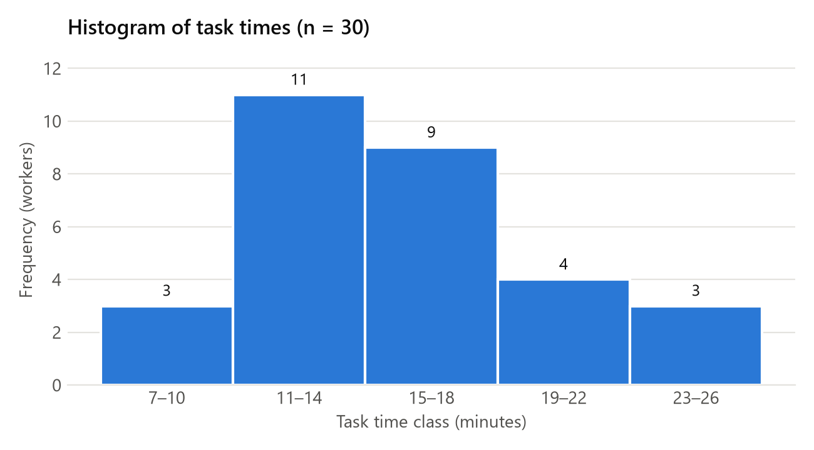
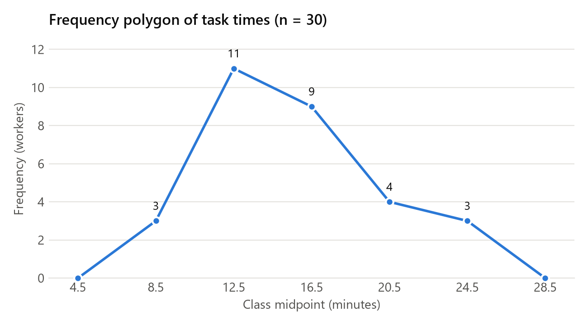

Lester S. Carcamo  
Principles of IQ (INFQ 7303) – Week 11  
Nov 2, 2026

# Statistical Problems – Answers

*Rounding: probabilities are reported to four decimal places (three significant figures when smaller than 0.01); all other final values to two decimal places. Intermediate values carry extra digits to avoid rounding error.*

---

## Time Sample Data (n = 30)

> The following data set represents a sample of the time in minutes taken by 30 workers to complete a given task. Use this time sample for Exercises 1, 2, and 3.
>
> 10, 15, 11, 17, 22, 14, 23, 8, 15, 11, 16, 12, 19, 26, 12, 11, 9, 16, 15, 24, 12, 17, 16, 14, 19, 13, 11, 15, 13, 21

---

## Exercise 1 – Frequency Table, Histogram, Frequency Polygon, Skewness

> Summarize the time sample data by organizing the data into class intervals, then
>
> a\) Create a frequency table with bins of size 4 starting at 7 (i.e. 7–10, 11–14, etc.) showing frequency, cumulative frequency, relative frequency, and cumulative relative frequency
>
> b\) Draw a histogram
>
> c\) Draw a frequency polygon chart
>
> d\) Is the distribution negatively or positively skewed?

**Given**

| Term | Value | Meaning |
|----|----|------------|
| n | 30 | number of workers in the sample |
| Bin width | 4 | width of each class interval |
| First bin | 7 | lower limit of the first class |

**Formulas**

```
Relative frequency = frequency / n
Cumulative relative frequency = cumulative frequency / n
```

### Count the values in each class

- 7–10: 8, 9, 10 → 3 values
- 11–14: 11 (×4), 12 (×3), 13 (×2), 14 (×2) → 11 values
- 15–18: 15 (×4), 16 (×3), 17 (×2) → 9 values
- 19–22: 19 (×2), 21, 22 → 4 values
- 23–26: 23, 24, 26 → 3 values

### Frequency table

| Class | Midpoint | Frequency | Cumulative Frequency | Relative Frequency | Cumulative Relative Frequency |
|---|---|---|---|---|---|
| 7–10 | 8.5 | 3 | 3 | 0.1000 | 0.1000 |
| 11–14 | 12.5 | 11 | 14 | 0.3667 | 0.4667 |
| 15–18 | 16.5 | 9 | 23 | 0.3000 | 0.7667 |
| 19–22 | 20.5 | 4 | 27 | 0.1333 | 0.9000 |
| 23–26 | 24.5 | 3 | 30 | 0.1000 | 1.0000 |
| **Total** | | **30** | | **1.0000** | |

### Histogram



### Frequency polygon

Frequency is plotted against the class midpoint and the points are joined with straight lines. A point with frequency 0 is added at midpoints 4.5 and 28.5 so the polygon closes on the axis at both ends.

| Midpoint | 4.5 | 8.5 | 12.5 | 16.5 | 20.5 | 24.5 | 28.5 |
|---|---|---|---|---|---|---|---|
| Frequency | 0 | 3 | 11 | 9 | 4 | 3 | 0 |



### Skewness

```
Rule: mean > median → positively skewed (tail to the right)
Pearson's coefficient of skewness: Sk = 3(x̄ − median) / s
```

**Substitute**

Sk = 3(15.23 − 15) / 4.56

**Solve**

Sk = 0.69 / 4.56 = 0.15

**Answer:** **Positively skewed.** The mean (15.23) is above the median (15), and Sk = 0.15 is positive but small, so the skew is mild. The peak is in the 11–14 class and the tail extends to the right, up to 26.

---

## Exercise 2 – Descriptive Statistics

> For the time sample calculate the mean, median, mode, range, standard deviation, and variance.

**Given**

| Term | Value | Meaning |
|----|----|------------|
| n | 30 | number of workers in the sample |
| Σx | 457 | sum of all 30 times |
| Minimum | 8 | shortest time |
| Maximum | 26 | longest time |

### Mean

```
x̄ = Σx / n
```

**Substitute**

x̄ = 457 / 30

**Answer:** x̄ = **15.23**

### Median

```
Median = average of the 15th and 16th ordered values (n = 30 is even)
```

**Substitute**

Median = (15 + 15) / 2

**Answer:** Median = **15**

### Mode

```
Mode = the most frequent value(s)
```

**Solve**

11 and 15 each appear 4 times; every other value appears 3 times or fewer.

**Answer:** Mode = **11 and 15** (bimodal)

### Range

```
Range = maximum − minimum
```

**Substitute**

Range = 26 − 8

**Answer:** Range = **18**

### Variance

```
s² = Σ(x − x̄)² / (n − 1)
```

**Substitute**

Σ(x − x̄)² = 603.37 (sum of the squared deviations from 15.23)

s² = 603.37 / 29

**Answer:** s² = **20.81**

### Standard deviation

```
s = √s²
```

**Substitute**

s = √20.81

**Answer:** s = **4.56**

If the 30 workers are treated as the whole population, the divisor is n instead of n − 1: σ² = 603.37 / 30 = 20.11 and σ = 4.48.

---

## Exercise 3 – Z-Scores

> Create a two-column table. List the values of the time sample in Exercise 1 in order from lowest to highest in the first column of the table. Assume that the population of task times for the workers is normally distributed, and in the second column of the table next to each time value in the first column, show its normalized value as a Z-score.

**Given**

| Term | Value | Meaning |
|----|----|------------|
| x̄ | 15.23 | sample mean (Exercise 2), estimates μ |
| s | 4.56 | sample standard deviation (Exercise 2), estimates σ |

```
z = (x − μ) / σ ≈ (x − x̄) / s
```

**Substitute** (example, x = 8)

z = (8 − 15.23) / 4.56

**Solve**

z = −7.23 / 4.56 = −1.59

**Answer:** the same calculation is applied to every value.

| Time (minutes) | Z-score |
|---|---|
| 8 | −1.59 |
| 9 | −1.37 |
| 10 | −1.15 |
| 11 | −0.93 |
| 11 | −0.93 |
| 11 | −0.93 |
| 11 | −0.93 |
| 12 | −0.71 |
| 12 | −0.71 |
| 12 | −0.71 |
| 13 | −0.49 |
| 13 | −0.49 |
| 14 | −0.27 |
| 14 | −0.27 |
| 15 | −0.05 |
| 15 | −0.05 |
| 15 | −0.05 |
| 15 | −0.05 |
| 16 | 0.17 |
| 16 | 0.17 |
| 16 | 0.17 |
| 17 | 0.39 |
| 17 | 0.39 |
| 19 | 0.83 |
| 19 | 0.83 |
| 21 | 1.26 |
| 22 | 1.48 |
| 23 | 1.70 |
| 24 | 1.92 |
| 26 | 2.36 |

---

## Exercise 4 – Face Cards

> In a standard deck of 52 playing cards, each suit has three face cards, a king, a queen, and a jack. What is the probability of drawing
>
> a\) Three face cards?
>
> b\) Three face cards that all belong to the same suit?

**Given**

| Term | Value | Meaning |
|----|----|------------|
| Deck | 52 | cards in the deck |
| Face cards | 12 | 3 per suit × 4 suits |
| Draws | 3 | drawn without replacement, so the counts drop after each draw |

Let A, B and C be the events that the first, second and third cards are face cards.

```
P(A ∩ B ∩ C) = P(A) × P(B | A) × P(C | A ∩ B)
```

### a) Three face cards

**Substitute**

P(A ∩ B ∩ C) = (12 / 52) × (11 / 51) × (10 / 50)

**Solve**

P(A ∩ B ∩ C) = 1,320 / 132,600

**Answer:** **0.00995** (about 1%)

### b) Three face cards, all of the same suit

The first card can be any face card; the second and third must be the 2 remaining face cards of that suit.

**Substitute**

P(A ∩ B ∩ C) = (12 / 52) × (2 / 51) × (1 / 50)

**Solve**

P(A ∩ B ∩ C) = 24 / 132,600

**Answer:** **0.000181** (about 0.018%)

---

## Exercise 5 – Committee

> The principal of a school wants to form a committee of senior students to come up with a new dress code. He wants the committee to have 3 female members and 2 male members. If there are 8 female seniors and 7 male seniors, how many possible committees can be formed?

**Given**

| Term | Value | Meaning |
|----|----|------------|
| Female seniors | 8 | choose 3 |
| Male seniors | 7 | choose 2 |

Order does not matter, so combinations are used.

```
C(N, M) = N! / (M! × (N − M)!)
Committees = C(8, 3) × C(7, 2)
```

**Substitute**

C(8, 3) = 8! / (3! × 5!)

C(7, 2) = 7! / (2! × 5!)

**Solve**

C(8, 3) = 40,320 / (6 × 120) = 56

C(7, 2) = 5,040 / (2 × 120) = 21

Committees = 56 × 21

**Answer:** **1,176** committees

---

## Exercise 6 – Source A / Source B

> Two sources of name and address data have been acquired and merged into a single file. In the combined file, 70% of the records came from Source A and 30% of the records are from Source B. It is also true that the names are correct on 80% of records from Source A, but only 50% of the Source B records have a correct name. Based on this information, answer the following questions.
>
> a\) If a record is randomly selected from the combined file, what is the probability that it originally came from File B?
>
> b\) If a record is randomly selected from the combined file, what is the probability that it will have a correct name?
>
> c\) If a record is selected from the combined file and is found to have a correct name, what is the probability that the record came from Source A? (Hint: use Bayes' Theorem where H = probability record is from Source A, and D = the name is correct.)

**Given**

| Term | Value | Meaning |
|----|----|------------|
| P(A) | 0.70 | record came from Source A |
| P(B) | 0.30 | record came from Source B |
| P(correct \| A) | 0.80 | name is correct, given the record is from Source A |
| P(correct \| B) | 0.50 | name is correct, given the record is from Source B |

### a) Probability the record came from Source B

P(B) is given directly.

**Answer:** P(B) = **0.30**

### b) Probability of a correct name

```
P(correct) = P(correct | A) × P(A) + P(correct | B) × P(B)
```

**Substitute**

P(correct) = (0.80)(0.70) + (0.50)(0.30)

**Solve**

P(correct) = 0.56 + 0.15

**Answer:** P(correct) = **0.71**

### c) Probability the record came from Source A, given a correct name

Following the hint, let H = the record is from Source A and D = the name is correct, so P(H) = 0.70, P(~H) = 0.30, P(D | H) = 0.80 and P(D | ~H) = 0.50.

```
P(H | D) = P(D | H) × P(H) / [ P(D | H) × P(H) + P(D | ~H) × P(~H) ]
```

**Substitute**

P(H | D) = (0.80)(0.70) / [ (0.80)(0.70) + (0.50)(0.30) ]

**Solve**

P(H | D) = 0.56 / (0.56 + 0.15) = 0.56 / 0.71

**Answer:** P(H | D) = **0.7887** (about 78.9%)

---

## Exercise 7 – Loan Default Screening (Bayes)

> Over time, a bank has found that 1% of its mortgage loans go into default for non-payment. To try and reduce this risk, a data scientist at the bank has developed a "big data" screening test that looks at the entire payment history of a mortgage loan and predicts whether the loan will go into default in the next 12 months. When the test was validated on historical loan data, the test showed positive 97% of the time when applied to data for loans that actually defaulted, but the test also showed (false) positive 2% of the time when it was applied to data for loans that did not default. Use Bayes' Theorem to answer the following question. What is the probability that a loan will go into default given that the new big data screening test is positive?

Let H = the loan defaults, ~H = the loan does not default, and D = the test is positive.

**Given**

| Term | Value | Meaning |
|----|----|------------|
| P(H) | 0.01 | a loan defaults |
| P(~H) | 0.99 | a loan does not default (1 − 0.01) |
| P(D \| H) | 0.97 | test is positive, given the loan defaults |
| P(D \| ~H) | 0.02 | test is positive, given the loan does not default (false positive) |

```
P(H | D) = P(D | H) × P(H) / [ P(D | H) × P(H) + P(D | ~H) × P(~H) ]
```

**Substitute**

P(H | D) = (0.97)(0.01) / [ (0.97)(0.01) + (0.02)(0.99) ]

**Solve**

P(H | D) = 0.0097 / (0.0097 + 0.0198) = 0.0097 / 0.0295

**Answer:** P(H | D) = **0.3288** (about 32.9%)

Even with a positive test, a loan is more likely not to default (about 67%), because defaults are rare (1%) and the 2% false-positive rate applies to the much larger group of non-defaulting loans.

---

## Exercise 8 – Overdue Accounts (Binomial, cumulative)

> A company reports that 15% of its accounts receivable are overdue. If an auditor takes a random sample of 8 accounts, what is the probability that no more than two accounts in the sample will be overdue? (Use the binomial distribution with cumulative probability.)

**Given**

| Term | Value | Meaning |
|----|----|------------|
| n | 8 | accounts sampled (trials) |
| p | 0.15 | an account is overdue (success) |
| 1 − p | 0.85 | an account is not overdue |
| s | ≤ 2 | number of overdue accounts (successes) |

```
P(X = s | p, n) = [ n! / (s! × (n − s)!) ] × pˢ × (1 − p)⁽ⁿ⁻ˢ⁾
P(X ≤ 2) = P(X = 0) + P(X = 1) + P(X = 2)
```

**Substitute**

P(X = 0 | 0.15, 8) = [ 8! / (0! × 8!) ] × (0.15)⁰ × (0.85)⁸

P(X = 1 | 0.15, 8) = [ 8! / (1! × 7!) ] × (0.15)¹ × (0.85)⁷

P(X = 2 | 0.15, 8) = [ 8! / (2! × 6!) ] × (0.15)² × (0.85)⁶

**Solve**

P(X = 0) = 1 × 1 × 0.2725 = 0.2725

P(X = 1) = 8 × 0.15 × 0.3206 = 0.3847

P(X = 2) = 28 × 0.0225 × 0.3771 = 0.2376

P(X ≤ 2) = 0.2725 + 0.3847 + 0.2376

**Answer:** P(X ≤ 2) = **0.8948** (about 89.5%)

Excel check: BINOM.DIST(2, 8, 0.15, TRUE) = 0.8948

---

## Exercise 9 – Survey Responses (Binomial)

> A marketing firm has implemented a customer satisfaction survey that it sends out to 500 customers each year. Over time the company has learned that there is about a 5% probability that a given prospect will complete the survey.
>
> a\) What is the probability that when the survey is given exactly 20 customers will respond? (Hint: use the binomial distribution without cumulative probability.)
>
> b\) What is the probability that at least 20 prospects will respond, i.e. 20 or more responses? (Hint: use the binomial distribution with cumulative probability.)

**Given**

| Term | Value | Meaning |
|----|----|------------|
| n | 500 | customers surveyed (trials) |
| p | 0.05 | a customer completes the survey (success) |
| 1 − p | 0.95 | a customer does not complete the survey |
| n × p | 25 | expected number of responses |

### a) Exactly 20 respond

```
P(X = s | p, n) = [ n! / (s! × (n − s)!) ] × pˢ × (1 − p)⁽ⁿ⁻ˢ⁾
```

**Substitute**

P(X = 20 | 0.05, 500) = [ 500! / (20! × 480!) ] × (0.05)²⁰ × (0.95)⁴⁸⁰

**Solve**

500! is too large to evaluate by hand, so Excel is used: BINOM.DIST(20, 500, 0.05, FALSE) = 0.0516

**Answer:** P(X = 20) = **0.0516** (about 5.2%)

### b) At least 20 respond

```
P(X ≥ 20) = 1 − P(X ≤ 19)
```

**Substitute**

P(X ≤ 19) = BINOM.DIST(19, 500, 0.05, TRUE) = 0.1272

**Solve**

P(X ≥ 20) = 1 − 0.1272

**Answer:** P(X ≥ 20) = **0.8728** (about 87.3%)

---

## Exercise 10 – Normal Distribution

> A normally distributed population of measurements has a population mean of 160 and a standard deviation of 8.
>
> a\) What is the probability that a measurement in the population will be less than 160?
>
> b\) What is the probability that a measurement in the population will be greater than 152?
>
> c\) What is the probability that a measurement in the population will be between 144 and 152?

**Given**

| Term | Value | Meaning |
|----|----|------------|
| μ | 160 | population mean |
| σ | 8 | population standard deviation |

```
z = (x − μ) / σ
P(X < x) = Φ(z), where Φ is the standard normal cumulative distribution
```

Values of Φ are taken from Excel's NORM.S.DIST(z, TRUE).

### a) P(X < 160)

**Substitute**

z = (160 − 160) / 8 = 0

**Solve**

P(X < 160) = Φ(0)

**Answer:** P(X < 160) = **0.5000**

### b) P(X > 152)

**Substitute**

z = (152 − 160) / 8 = −1

**Solve**

P(X > 152) = 1 − Φ(−1) = 1 − 0.1587

**Answer:** P(X > 152) = **0.8413**

### c) P(144 < X < 152)

**Substitute**

z₁ = (144 − 160) / 8 = −2

z₂ = (152 − 160) / 8 = −1

**Solve**

P(144 < X < 152) = Φ(−1) − Φ(−2) = 0.1587 − 0.0228

**Answer:** P(144 < X < 152) = **0.1359**

---

## Exercise 11 – Confidence Intervals

> The time required to complete a routine quality check process is known to be normally distributed with a standard deviation of 3 minutes. If a sample of 225 quality check records yields a mean of 12 minutes, then
>
> a\) Construct a 95% confidence interval
>
> b\) Construct a 90% confidence interval
>
> Suppose instead that the sample size is 100 with a mean of 12 minutes. In this case
>
> c\) Construct a 95% confidence interval
>
> d\) Construct a 90% confidence interval

**Given**

| Term | Value | Meaning |
|----|----|------------|
| σ | 3 | known population standard deviation (minutes) |
| x̄ | 12 | sample mean (minutes) |
| n | 225 or 100 | sample size (first and second case) |
| z | 1.96 | critical value for 95% confidence (α = 0.05) |
| z | 1.645 | critical value for 90% confidence (α = 0.10) |

```
SE = σ / √n
CI = x̄ ± z × SE
```

### Standard errors

n = 225: SE = 3 / √225 = 3 / 15 = 0.2

n = 100: SE = 3 / √100 = 3 / 10 = 0.3

### a) n = 225, 95% confidence

**Substitute**

CI = 12 ± 1.96 × 0.2

**Solve**

CI = 12 ± 0.392

**Answer:** **(11.61, 12.39)**

### b) n = 225, 90% confidence

**Substitute**

CI = 12 ± 1.645 × 0.2

**Solve**

CI = 12 ± 0.329

**Answer:** **(11.67, 12.33)**

### c) n = 100, 95% confidence

**Substitute**

CI = 12 ± 1.96 × 0.3

**Solve**

CI = 12 ± 0.588

**Answer:** **(11.41, 12.59)**

### d) n = 100, 90% confidence

**Substitute**

CI = 12 ± 1.645 × 0.3

**Solve**

CI = 12 ± 0.494

**Answer:** **(11.51, 12.49)**

### Summary

| Sample size | Confidence | Margin of error | Interval | Width |
|---|---|---|---|---|
| 225 | 95% | 0.39 | (11.61, 12.39) | 0.78 |
| 225 | 90% | 0.33 | (11.67, 12.33) | 0.66 |
| 100 | 95% | 0.59 | (11.41, 12.59) | 1.18 |
| 100 | 90% | 0.49 | (11.51, 12.49) | 0.99 |

A smaller sample gives a wider interval, and a higher confidence level gives a wider interval.

---

## Exercise 12 – Hypothesis Test of Average A/R Balance

> An auditor wants to test the claim that the average A/R balance is $755. A random sample of 49 accounts is examined and found to have a mean of $730 and a standard deviation of $58. Should the auditor's claim be accepted or rejected
>
> a\) At the 5% significance level?
>
> b\) At the 1% significance level?

**Given**

| Term | Value | Meaning |
|----|----|------------|
| H₀ | μ = 755 | null hypothesis: the claimed average A/R balance |
| Hₐ | μ ≠ 755 | alternative hypothesis: the average differs from the claim |
| n | 49 | accounts sampled |
| x̄ | 730 | sample mean |
| s | 58 | sample standard deviation (estimates σ, since n ≥ 30) |
| IC | 1.96 | interval coefficient for 95% confidence (α = 0.05) |
| IC | 2.58 | interval coefficient for 99% confidence (α = 0.01) |

```
SE = s / √n
z = (x̄ − μ) / SE
Critical values = μ ± IC × SE
Reject H₀ if x̄ falls outside the critical values (equivalently, if |z| > IC)
```

### Standard error and test statistic

SE = 58 / √49 = 58 / 7 = 8.286

z = (730 − 755) / 8.286 = −25 / 8.286 = −3.02

### a) 5% significance level (α = 0.05)

**Substitute**

Critical values = 755 ± 1.96 × 8.286

**Solve**

Critical values = 755 ± 16.24

Lower critical value = 738.76, upper critical value = 771.24

**Answer:** **Reject H₀.** x̄ = 730 is below the lower critical value of 738.76 (equivalently, |z| = 3.02 > 1.96).

### b) 1% significance level (α = 0.01)

**Substitute**

Critical values = 755 ± 2.58 × 8.286

**Solve**

Critical values = 755 ± 21.38

Lower critical value = 733.62, upper critical value = 776.38

**Answer:** **Reject H₀.** x̄ = 730 is below the lower critical value of 733.62 (equivalently, |z| = 3.02 > 2.58).

**Conclusion:** The auditor's claim that the average A/R balance is $755 should be rejected at both the 5% and the 1% significance levels.
